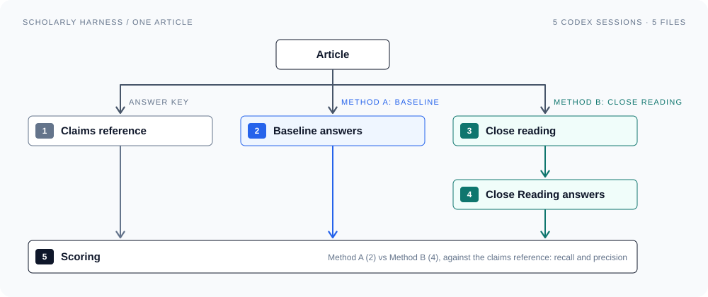
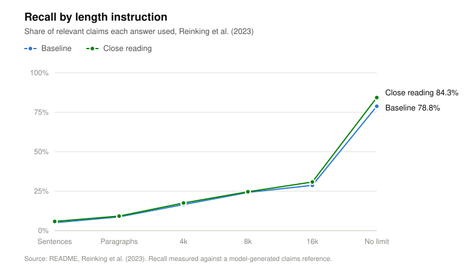

# hitl-research-agent

A human-in-the-loop AI research framework for analyzing sources, evaluating arguments, and synthesizing findings across a research collection. The project investigates how AI can support rigorous research while keeping human judgment and intellectual direction central.

> Can AI meaningfully support rigorous, evidence-grounded research?

## Purpose

Researchers are right to be skeptical of AI for synthesis: models misattribute claims, drop qualifications, and cite evidence that does not support them. This project tests whether that skepticism can be answered. It builds an analysis process in which every step can be checked, and applies it to a real study. Led by a professor of literacy education, the study investigates how the science of reading is defined and enacted as it travels across three corpora: scholarly publications, popular press, and legislation. The researcher sets the questions and judges what the evidence means. The system's job is to find that evidence, quote it exactly, cite it to the page, and attribute it to its speaker.

Before AI can be relied on to judge an argument, it has to be judged itself. The project began with that problem. Models used to summarize and analyze articles misattributed claims, left out important qualifications, and attached evidence that did not support their interpretations. The system therefore evaluates both how faithfully the model represents a source and how well it reasons about the authors' claims. The question is whether its analysis helps the researcher understand an argument, or gives her errors to correct.

The case for using AI to support research still has to be made.

> Why use AI when a researcher can read the articles and evaluate the authors' arguments herself?

To earn its place, the system must add something worthwhile: comparing explanations across sources, noticing conflicting evidence, or identifying an assumption worth investigating. The test is practical. Does it support better research, at a cost in time and money that justifies building and running it? And will it be used consistently?

## The research question

A professor of literacy education, who is also my mother, consulted me as an engineer to help her design a rigorous research system to answer her research question:

**How is the science of reading defined and enacted as it travels across three corpora: scholarly publications, popular press, and legislation?**

### The study

The [science of reading study](studies/science_of_reading/) uses critical discourse analysis across the three corpora.

Working title: *Science by Other Means: Reading Research, Legislative Mandates, and the Spaces Between*

In research, the science of reading is broad: the idea that there is a scientific basis for how we teach reading. By the time it reaches legislation, it is often reduced to directives such as "phonics first" or "don't use three-cueing." The study traces that pathway and where things are lost in translation. It does not evaluate whether any approach to reading instruction is effective.

Each document in every corpus is asked the same three questions:

1. **How is the science of reading defined, and how is it enacted?**
2. **How is teachers' knowledge positioned?**
3. **How are students positioned?**

## Methods

The study applies the same analysis to each of its three corpora. Each design choice has been tested as a small experiment of its own rather than assumed:

- **Close reading versus the article alone:** whether answering from a prior close reading gives better answers than answering from the article directly.
- **Codebook versus model as judge:** whether the analysis is evaluated against the researcher's codebook or scored by a second model against a rubric.
- **Retrieval and synthesis:** how completely the model retrieves the passages that answer each question, and how those passages are combined across documents to answer the research question.
- **Answer length:** how the length of an answer trades fidelity against verbosity, tested in the experiment below.

### Why Codex

In earlier water-study tests, Codex narrowly beat the API and ChatGPT app, and medium effort beat high. A separate comparison favored reading the PDF directly over prepared text; the costlier model did not read better. Those [experiments are preserved on `wip-2026-11-25`](https://github.com/kaseymallette/hitl-research-agent/blob/wip-2026-11-25/studies/water/README.md#the-ab-experiments). These were tests on two articles, so they support the current setup rather than establish a general winner.

The harness uses GPT-6.1 Sol at medium effort through Codex with API billing. Each step runs in its own session with only the files it needs.

### Cost

The harness first ran through Codex on a ChatGPT subscription, within the plan's usage limits rather than billed per token. When those limits changed, the runner moved to API billing, which charges for every token. Each run now has a measurable cost: the answer-length experiment on the first scholarly article cost $11.43 in API fees, and a single scoring step read about 3.5 million tokens, most of them cached. Balancing subscription limits against API fees is part of the design, and it bears directly on whether the system justifies its cost.

## Scholarly articles

Each step runs in a separate Codex session that reads the source PDF and sees only the files it needs.

- **Claims reference:** an independent list of every claim in a document, quoted exactly with its page and voice (the authors' own, or a view they report, endorse, or dispute). It is written from the document alone, without the questions.
- **Close reading:** a reading of the document from beginning to end, recording each passage that bears on the three questions.
- **Answers:** each question is answered by key points, each supported by exact quotations with their pages and attribution, and with no interpretation by the model.
- **Scoring:** answers are scored against the claims reference.
  - **Precision:** exact, real, relevant, correctly attributed quotations ÷ total quotations. A quotation of a view the authors dispute counts only if the answer says whose view it is.
  - **Recall:** relevant claims used ÷ total relevant claims.

Two methods answer the questions, and the null hypothesis is that Method B is no better than Method A.

| Method | How it answers |
| --- | --- |
| **A: Baseline** | Answers directly from the article. |
| **B: Close reading** | First collects relevant passages, then uses that close reading and the article to answer. |



See the [scholarly harness](studies/science_of_reading/harness/scholarly/) for run instructions and prompts.

## Experiment: Fidelity versus verbosity

### Objective

The researcher asked for complete, traceable evidence: every relevant passage quoted exactly, cited to its page, and attributed to its speaker, with no interpretation added by the model. This experiment tests how the length of an answer affects its fidelity to that standard: how much of the relevant evidence the model retrieves, how accurately it quotes, and how long the answer becomes.

### Design

- **Source:** the first scholarly article, Reinking, Hruby, and Risko (2023).
- **Variable:** the length instruction in the answer prompt, at six levels: a few sentences, a few paragraphs, under 4,000 words, under 8,000 words, under 16,000 words, and no limit. Word limits apply to the whole answer, all three questions together.
- **Held constant:** every other instruction. Answers are organized by key points, each supported by exact quotations with page numbers and attribution, and contain no interpretation.
- **Methods:** each level is run with both methods, the baseline (the article alone) and close reading (the article and its close reading).
- **Reference:** every level is scored against the same 623 relevant claims, drawn from the article's claims reference.

### Measures

- **Recall and precision,** as defined under [Scholarly articles](#scholarly-articles).
- **Verbosity:** the number of quotations and the length of the answer in words.

### Results

| Length instruction | Baseline recall | Close-reading recall | Precision (baseline / close reading) | Quotations (baseline / close reading) | Words (baseline / close reading) |
| --- | --- | --- | --- | --- | --- |
| A few sentences<br>(≈1,000 words) | 5.0% | 5.8% | 100% / 100% | 20 / 22 | 1,114 / 1,296 |
| A few paragraphs<br>(≈2,000 words) | 8.7% | 9.2% | 100% / 100% | 38 / 41 | 1,957 / 2,152 |
| Under 4,000 words | 16.5% | 17.5% | 100% / 100% | 54 / 72 | 2,752 / 3,373 |
| Under 8,000 words | 24.2% | 24.6% | 100% / 100% | 75 / 113 | 4,320 / 5,539 |
| Under 16,000 words | 28.7% | 30.8% | 100% / 100% | 103 / 164 | 6,112 / 7,651 |
| No limit | 78.8% | 84.3% | 99.4% / 98.8% | 166 / 426 | 16,139 / 21,801 |



### Findings

- **Precision held at every length.** The quotations were accurate whatever the instruction; length changed how much evidence the answers showed, not whether it was right.
- **Recall rose with length but stayed low under every limit.** It climbed from 5% for a few sentences to 29–31% under 16,000 words. Only the instruction to include everything brought it near 80%.
- **Any limit made the model select.** Under the 16,000-word limit, the answers ran about 6,100 and 7,700 words, well short of the limit and of the 16,000 words the baseline wrote with no limit, and recall stayed near 30%. The models never used their full allowance under any limit. The jump came from removing the limit, not from the room it allowed.
- **The length instruction mattered far more than the method.** The close-reading step added about two points of recall or less under each limit and about five points without one.
- **With no limit, the baseline answer nearly reproduced the claims reference.** Told to include everything, the answer from the article alone used 78.8% of the relevant claims without seeing the reference. The claims reference is not needed to produce the answers; it is needed only to measure them, as the independent list of what an answer missed. Without it, an answer can be checked for precision against the article but has nothing to be scored against for recall.

### Data

The results are in [`outputs/scholarly/reinking_et_al_2023_legislating_phonics/`](studies/science_of_reading/outputs/scholarly/reinking_et_al_2023_legislating_phonics/). The claims reference and close reading are shared by every level; each level's answers, scoring, and prompts are in its own folder: `few_sentences/`, `few_paragraphs/`, `words_4000/`, `words_8000/`, `words_16000/`, and `no_length_limit/`.

### Implications

The experiment suggests a leaner design for the remaining seven scholarly articles: drop the close reading, which added little, and answer the questions from the article with no length limit.

1. **Test the next two articles.** Run the claims reference, then the questions from the article, then the evaluation, to test whether there is a difference between the claims reference and the questions from the article.
2. **Decide on the remaining five.** If there is little difference, the questions from the article may be all those five need, checked for precision against the article. If there is a difference, the answer step needs to change before running them.

## Legislation

A separate session checks each law's close reading against the law and its claims reference. A discourse analysis then examines word choices, assumptions, what is emphasized or left out, how people are positioned, and how other texts are invoked, and another session checks each observation against the law and its assigned code.


See the [legislation harness](studies/science_of_reading/harness/legislation/) for the workflow and prompts, and the [codebook](studies/science_of_reading/docs/CODEBOOK.md) for the discourse-analysis dimensions. The popular press has not been started.

### Findings: six state laws

Six laws have been analyzed and judged: California AB 1454 (2025), Arkansas's Right to Read Act (2017) and its 2025 code, Ohio (2026), Georgia HB 1193 (2026), and Minnesota's Read Act (2026). Three of the expert's questions are answered from those analyses:

- **[How is the science of reading defined?](studies/science_of_reading/questions/01_how_is_the_science_of_reading_defined.md)** Only Ohio and Arkansas 2025 define it outright, and differently: Ohio as a body of evidence, Arkansas as a field of study. The other laws give it content through a list of instructional components, a manner of teaching ("explicit, systematic"), or a ban on three-cueing.
- **[How is teachers' knowledge positioned?](studies/science_of_reading/questions/02_how_is_teachers_knowledge_positioned.md)** As something the state must verify, update, and supervise, through credentials, required training, and fidelity checks. No law says outright that teachers lack the knowledge, and most also owe them support.
- **[How are students positioned?](studies/science_of_reading/questions/03_how_are_students_positioned.md)** As beneficiaries of required intervention and as objects of measurement and placement. The laws divide on retention, and range from treating English learners as exceptions to treating their home languages as assets. Students never speak or act.

These cover legislation only.

## Development

After three months of development, the system has moved further from answering the researcher's question rather than closer to it. The drift began with a design decision made by Claude, the AI coding assistant that wrote the system, and continued through the following:

1. **Verifying quotations created its own machinery.** Models misquote sources, so every quotation in the model's analysis had to be confirmed as the article's actual words. Checking that automatically required a machine-readable copy of each article, so Claude wrote code to extract the text from its PDF and compared each quotation against it. The extracted text was never a perfect copy of the article: accurate quotations failed to match it, and analyses were rejected over them, so the check meant to catch the model's errors began producing errors of its own. Effort shifted to how text should be extracted and standardized, rather than whether the model's reading answered the research question.

2. **Model selection became a moving target.** The project began on OpenAI's GPT-5.6 Sol, and when the GPT-6 models were released, the study was designed to compare GPT-6 Astra, the highest-reasoning model, with GPT-6 Sol. A few weeks later, OpenAI released GPT-6.1 Sol and reported that it could do what Astra did with far fewer tokens and in less time. By the time the model comparison was ready, the vendor's own claims had already addressed the question it was built to answer, though not on this task, and GPT-6.2 Sol has since been released. Keeping pace with new models drew effort toward model comparison and away from the research question.

3. **Claude objected to the research question itself.** Claude objected that *travel* was undefined, and recorded in the project's decision file that the researcher needed to specify what travels (a claim, a term, a cited study) and how it would be traced. The objection treated an exploratory question as an incomplete specification. Discovering how the science of reading travels across the three corpora is what the research sets out to do, not a definition the researcher owed the system before it could be built.

4. **Close reading was separated from argument evaluation.** The design came from a pilot study on freshwater use in data center cooling, where Claude suggested reading an article by hand and taking notes as a source of truth for the model. The notes followed a researcher's two passes through a text: a close reading of what the authors claimed, then an evaluation arguing an interpretation of the text from its evidence. The system was designed to model both passes. That raised a question the design could not settle: what is a model's interpretation of a text other than generated text, and can a model have an interpretation at all?

5. **Evaluation became circular.** The first approach used a model as judge, scoring the analysis against a rubric, but a model judging a model's reading is circular. The researcher then proposed a codebook, but its first draft had been written with AI, which made it circular in the same way. The only standard independent of the model was the researcher's own coding of the articles. That standard is sound, but it moves the labor back to the researcher, and agreement on a small hand-coded sample would not prove the system sound: the model's output is generated text, and its accuracy on a few articles says little about articles that are more specialized, obscure, or nuanced. The question became how much of the researcher's labor a trustworthy system requires, and whether any evaluation could be trusted without the researcher reading the sources directly.

6. **Retrieval became a question of precision and recall.** Answering the research question requires the model to find the passages in each article that bear on it. Precision is straightforward to measure: of the passages the model quoted, how many were exact and relevant. Recall is harder: of all the relevant passages in the article, how many did the model find. The gold standard is for the researcher to mark every relevant passage and compare the model's answers against them, the same labor-intensive work the system was meant to reduce; without it, recall is measured against a model-generated reference of the article's claims, which brings back the circularity of the previous problem.

7. **Avoiding interpretation created verbosity.** Asking the model to retrieve the relevant passages leaves the model to decide what *relevant* means. Under a length limit, the model also decides which of those passages to keep, and that selection is itself an interpretation of the text, the very thing the researcher asked the model not to supply. The only way to keep the model from choosing was to ask for every relevant passage, and the answers that came back were verbose and granular.

8. **The coding assistant added requirements no one asked for.** Claude repeatedly built its own assumptions into the system: a limit of a few sentences on each answer, interpretation lines beneath each quotation, and an audit of the close reading inside the step meant only to answer the questions. Each looked reasonable in isolation, and each changed what the experiment measured; finding and removing them cost paid runs. When corrected, Claude often overcorrected, removing more than was asked. Supervising the assistant became a substantial part of the engineering work.

## Status

- **Done:** six state laws analyzed and judged; the codebook revised from them; three of the expert's questions answered.
- **In progress:** running the harness on the scholarly articles.
- **Next:** the popular press.

Decisions and open questions are in [`docs/PROJECT.md`](docs/PROJECT.md).

## Layout

```
├── docs/
│   ├── PROJECT.md                 the questions, current decisions, and status
│   └── ENGINEERING_DIRECTIVES.md  the coding baseline
├── studies/
│   └── science_of_reading/        the study: corpora, codebook, prompts, results, and answered questions
├── scripts/
│   ├── run_scholarly.py           the scholarly harness: five Codex sessions per article
│   └── workspace.py               legislation: load a law into the Codex workspace, save its results
├── src/hitl_research_agent/       the data models for a source's provenance
└── tests/
```

Earlier versions are kept as tags: `v1-final`, and `v2-final` (the A/B
experiments, the decision records, the prompt log, and the API pipeline). The
science of reading study was developed separately and is kept as `mom-research-final`.
The water study, where the analysis harness was built, and the retrieval
experiments are in git history and on the `wip-2026-11-25` branch.

## Setup and checks

```bash
uv sync
```

```bash
uv run pytest
```

```bash
uv run ruff check . && uv run ruff format --check .
```

```bash
uv run mypy src
```

## Harness

Run these commands from the repository root with `OPENAI_API_KEY` set in your shell. The scholarly runner passes it to Codex as `CODEX_API_KEY`, overriding saved ChatGPT sign-in. An existing `CODEX_API_KEY` also works; `OPENAI_API_KEY` takes precedence if both are set.

### Scholarly articles

Choose an article slug from `studies/science_of_reading/data/scholarly/sources.yaml`:

```bash
uv run python scripts/run_scholarly.py <slug>
```

Runs all five steps in separate Codex sessions and saves results to `studies/science_of_reading/outputs/scholarly/<slug>/`. Existing outputs are skipped, so the same command resumes an interrupted run.

To rerun only the close reading:

```bash
uv run python scripts/run_scholarly.py <slug> --only 03
```

### Legislation

For the manual legislation sessions, sign the Codex CLI in with your API key:

```bash
printenv OPENAI_API_KEY | codex login --with-api-key
```

Choose a law's slug from `studies/science_of_reading/data/legislation/sources.yaml` and load it:

```bash
uv run python scripts/workspace.py load <slug>
```

In `~/sor-workspace`, follow the workspace README to run its five prompts in separate Codex sessions: close reading, claims reference, close-reading judgment, discourse analysis, and discourse-analysis judgment.

Save the results back to the repository:

```bash
uv run python scripts/workspace.py save
```

Results go to `studies/science_of_reading/outputs/legislation/<slug>/`; saving removes the temporary workspace.
