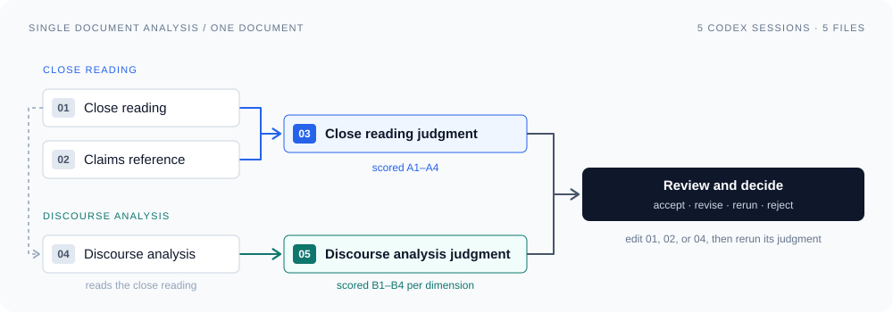

# hitl-research-agent

A human-in-the-loop AI research framework for analyzing sources, evaluating arguments, and synthesizing findings across a research collection. The project investigates how AI can support rigorous research while keeping human judgment and intellectual direction central.

> Can AI meaningfully support rigorous, evidence-grounded research?

## Purpose

Researchers are right to be skeptical of AI for synthesis: models misattribute claims, drop qualifications, and cite evidence that doesn't support them. This project builds an analysis process that can be checked at every step. Each document gets a close reading, and each point in its answers is traced to the page it comes from. The analysis is then compared across documents to answer a researcher's questions. It is applied to a real study, done with a professor of literacy education who directs the questions and judges what the evidence means.

## Overview

I’m building this framework to become a better researcher: to work through more literature, make connections across sources, and pursue questions I might otherwise miss. I want AI to help me evaluate the authors’ arguments: whether their evidence supports their claims, whether their methods justify their conclusions, and what assumptions or limitations affect those conclusions.

### Judging the judge

But before I can rely on AI to judge an argument, I need to judge AI. When using models to summarize and analyze articles, I’ve noticed that they can misattribute claims, leave out important qualifications, or attach evidence that does not support their interpretations. This project therefore evaluates both how faithfully the model represents a source and how well it reasons about the authors’ claims. I need to know whether its assessment helps me understand the argument or gives me errors to correct.

### AI as a research assistant?

The justification to use AI to support research still needs to be made, and that is what this system is for.

> Why use AI when I can read the articles and evaluate the authors' arguments myself?

The AI agents need to add something worthwhile, whether that is helping me compare explanations, noticing conflicting evidence, or identifying an assumption worth investigating. *Does this system help me conduct better research that justifies the time and money spent to build and implement it?* *Will I use it to support my research consistently?*

## The science of reading study

The [science of reading study](studies/science_of_reading/) is a collaboration with a professor of literacy education. It examines how the science of reading is defined, simplified, and contested as it moves from scholarship, through the popular press, into state legislation, using critical discourse analysis across the three corpora.

Working title: *Science by Other Means: Reading Research, Legislative Mandates, and the Spaces Between*

In research, the science of reading is broad: the idea that there is a scientific basis for how we teach reading. By the time it reaches legislation, it is often reduced to directives such as "phonics first" or "don't use three-cueing." The study traces that pathway and where things are lost in translation. It does not evaluate whether any approach to reading instruction is effective.

## Findings so far: six state laws

Six laws have been analyzed and judged: California AB 1454 (2025), Arkansas's Right to Read Act (2017) and its 2025 code, Ohio (2026), Georgia HB 1193 (2026), and Minnesota's Read Act (2026). Three of the expert's questions are answered from those analyses:

- **[How is the science of reading defined?](studies/science_of_reading/questions/01_how_is_the_science_of_reading_defined.md)** Only Ohio and Arkansas 2025 define it outright, and differently: Ohio as a body of evidence, Arkansas as a field of study. The other laws give it content through a list of instructional components, a manner of teaching ("explicit, systematic"), or a ban on three-cueing.
- **[How is teachers' knowledge positioned?](studies/science_of_reading/questions/02_how_is_teachers_knowledge_positioned.md)** As something the state must verify, update, and supervise, through credentials, required training, and fidelity checks. No law says outright that teachers lack the knowledge, and most also owe them support.
- **[How are students positioned?](studies/science_of_reading/questions/03_how_are_students_positioned.md)** As beneficiaries of required intervention and as objects of measurement and placement. The laws divide on retention, and range from treating English learners as exceptions to treating their home languages as assets. Students never speak or act.

These cover legislation only. The scholarly articles are being run now.

## Scholarly articles: does close reading give better answers?

We ask the same three questions of each article: how is the science of reading defined and enacted, how is teachers' knowledge positioned, and how are students positioned?

### Two methods

Both quote the article’s exact words.

| Method | How it answers |
| --- | --- |
| **A: Baseline** | Answers directly from the article. |
| **B: Close reading** | First collects relevant passages, then uses that close reading and the article to answer. |

### What is measured

- **Precision:** exact, real, relevant quotes ÷ total quotes.
- **Recall:** relevant claims used ÷ total relevant claims.

Both methods are scored against an independent **claims reference**, created from the article without seeing the questions or answers.

The null hypothesis is that Method B is no better than Method A.

### Workflow

Each step runs in a separate Codex session and sees only the files it needs.


See the [scholarly harness](studies/science_of_reading/harness/scholarly/) for run instructions and output files.

## Legislation: how do laws frame reading instruction?

Each law gets a close reading and an independent claims reference. A separate session checks the close reading against the law and that reference.

The discourse analysis then uses the law and close reading to examine word choices, assumptions, what is emphasized or left out, how people are positioned, and how other texts are invoked. Another session checks each observation against the law and its assigned code.



See the [legislation harness](studies/science_of_reading/harness/legislation/) for the workflow and prompts, and the [codebook](studies/science_of_reading/docs/CODEBOOK.md) for the analysis dimensions.

## Development approach and lessons

Two coding assistants helped me build this project.

- **Claude Code** is responsible for all of the code.
- **Codex** helps with design and prompt writing.

Neither decides what I research or what the evidence means.

What has been difficult about working this way:

- Each implementation step produced the next step’s problem, and the design
  grew to absorb every one. A safeguard added for one failure became the thing
  the next step had to work around. The accumulated machinery eventually cost
  more than the failures it caught, and removing it took longer than building
  it had.
- The architecture drifted without my deciding it should. No single step chose
  to turn quotation matching into a hard acceptance gate, but it arrived there
  across many small changes that each looked reasonable at the time, and the
  direction was only visible in aggregate.
- The coding assistants did not consistently follow my instructions. I had to repeat requirements, correct assumptions, and undo changes I had not asked for. That took time and money away from the research and made supervising the assistants a substantial part of the work.

## Status

- **Done:** six state laws analyzed and judged; the codebook revised from them; three of the expert's questions answered.
- **In progress:** running the harness on the scholarly articles.
- **Next:** the popular press.

Decisions and open questions are in [`docs/PROJECT.md`](docs/PROJECT.md).

## Layout

```
├── docs/
│   ├── PROJECT.md                 the questions, current decisions, and status
│   └── ENGINEERING_DIRECTIVES.md  the coding baseline
├── studies/
│   └── science_of_reading/        the study: corpora, codebook, prompts, results, and answered questions
├── scripts/
│   ├── run_scholarly.py           the scholarly harness: five Codex sessions per article
│   └── workspace.py               legislation: load a law into the Codex workspace, save its results
├── src/hitl_research_agent/       the data models for a source's provenance
└── tests/
```

Earlier versions are kept as tags: `v1-final`, and `v2-final` (the A/B
experiments, the decision records, the prompt log, and the API pipeline). The
science of reading study was developed separately and is kept as `mom-research-final`.
The water study, where the analysis harness was built, and the retrieval
experiments are in git history and on the `wip-2026-11-25` branch.

## Setup and checks

```bash
uv sync
```

```bash
uv run pytest
```

```bash
uv run ruff check . && uv run ruff format --check .
```

```bash
uv run mypy src
```

## Harness

### Why Codex

In earlier water-study tests, Codex narrowly beat the API and ChatGPT app, and medium effort beat high. A separate comparison favored reading the PDF directly over prepared text; the costlier model did not read better. Those [experiments are preserved on `wip-2026-11-25`](https://github.com/kaseymallette/hitl-research-agent/blob/wip-2026-11-25/studies/water/README.md#the-ab-experiments). These were tests on two articles, so they support the current setup rather than establish a general winner.

The harness uses GPT-6.1 Sol at medium effort through Codex, within the ChatGPT plan without a separate API key. Each step runs in its own session with only the files it needs.

Run these commands from the repository root.

### Scholarly articles

Choose an article slug from `studies/science_of_reading/data/scholarly/sources.yaml`:

```bash
uv run python scripts/run_scholarly.py <slug>
```

Runs all five steps in separate Codex sessions and saves results to `studies/science_of_reading/outputs/scholarly/<slug>/`. Existing outputs are skipped, so the same command resumes an interrupted run.

To rerun only the close reading:

```bash
uv run python scripts/run_scholarly.py <slug> --only 03
```

### Legislation

Choose a law's slug from `studies/science_of_reading/data/legislation/sources.yaml` and load it:

```bash
uv run python scripts/workspace.py load <slug>
```

In `~/sor-workspace`, follow the workspace README to run its five prompts in separate Codex sessions: close reading, claims reference, close-reading judgment, discourse analysis, and discourse-analysis judgment.

Save the results back to the repository:

```bash
uv run python scripts/workspace.py save
```

Results go to `studies/science_of_reading/outputs/legislation/<slug>/`; saving removes the temporary workspace.
