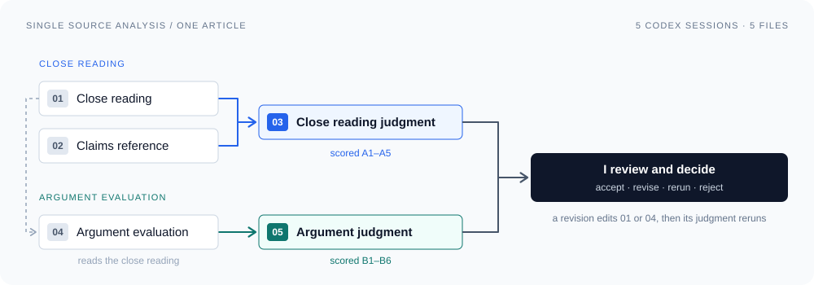
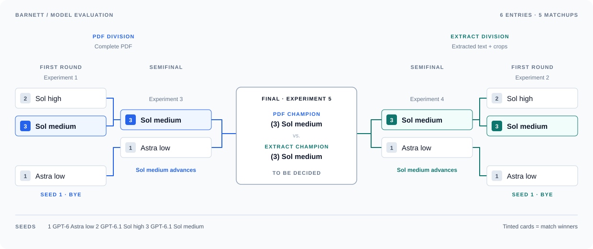
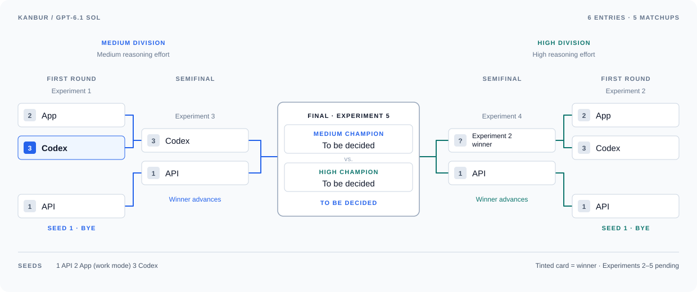

# hitl-research-agent

A human-in-the-loop multi-agent research framework for building and examining a collection of evidence across articles. Three AI agents handle these tasks: single source analysis, synthesis, and a research assistant, giving researchers a way to examine individual arguments, understand how they relate across a research collection, and get their bearings in an unfamiliar field.

The analyses connect authors’ claims to their evidence, methods, assumptions, and limitations, while making the model’s own interpretations explicit. A separate evaluation step checks whether those analyses faithfully represent the sources and whether their assessments of the authors’ arguments are justified. Researchers review the results before adding them to their collection, and use that collection to investigate disagreements, gaps, and new questions.

## Purpose

I’m building this framework to become a better researcher: to work through more literature, make connections across sources, and pursue questions I might otherwise miss. I want AI to help me evaluate the authors’ arguments: whether their evidence supports their claims, whether their methods justify their conclusions, and what assumptions or limitations affect those conclusions.

But before I can rely on AI to judge an argument, I need to judge AI. When using models to summarize and analyze articles, I’ve noticed that they can misattribute claims, leave out important qualifications, or attach evidence that does not support their interpretations. This project therefore evaluates both how faithfully the model represents a source and how well it reasons about the authors’ claims. I need to know whether its assessment helps me understand the argument or gives me errors to correct.

### AI as a research assistant?

The justification to use AI to support research still needs to be made, and that is what this system is for.

> Why use AI when I can read the articles and evaluate the authors' arguments myself?

The AI agents need to add something worthwhile, whether that is helping me compare explanations, noticing conflicting evidence, or identifying an assumption worth investigating. *Does this system help me conduct better research that justifies the time and money spent to build and implement it?* *Will I use it to support my research consistently?*


## Research

This framework is intended to support research across different topics. My starting point is a broader investigation into how we can build AI better, with this first question focused on the infrastructure that supports it and the water it uses. As that investigation develops, I want to build on the evidence already collected and pursue new questions.

### Pilot study

> Why does AI infrastructure use freshwater, and under what conditions could
> alternative cooling methods or water supplies, including desalination, reduce
> pressure on local freshwater resources?

The investigation distinguishes freshwater, drinking-quality water, and water
suitable for a particular process, and examines desalination as a possible
supply option rather than assuming it is the preferred one. These distinctions
matter for relevance: a source about process-grade cooling water is not
evidence about drinking water, and treating them as the same thing is the first
way a judgment about relevance goes wrong.

Synthesis uses 7 articles, in
[`data/research/synthesis/`](data/research/synthesis). Two of them, Barnett
and kanbur, are also the experiment set in
[`data/research/ab_testing/`](data/research/ab_testing).

I collected the articles for this pilot study myself, using the research question to identify relevant sources. For finding articles later, I plan to pilot Consensus, a tool built for that work. Nothing in this system receives the research question, so its outputs can support other research questions as the collection grows.


## Design

### Three agents

| Agent | Given | Produces | Status |
| --- | --- | --- | --- |
| **Single source analysis** | one article | a close reading and an argument evaluation, each with a judgment | working |
| **Synthesis** | the accepted close readings | a comparison of what the authors claim, with each position attributed to its source | planned |
| **Research assistant** | one article | a primer on the article's field, and later guided questions about it | primer working |

No agent is given a research question, so its output isn't shaped to one
question and can be reused for others
([ADR-0006](docs/adr/0006-analysis-and-synthesis-never-receive-the-question.md),
[ADR-0018](docs/adr/0018-three-agents-analysis-synthesis-research-assistant.md)).
Synthesis will read only the close readings: the argument evaluation is the
model's opinion, and it stays out of what the sources are said to claim.

I make the decisions. I accept, revise, rerun, or reject each analysis, and
only accepted ones enter the collection.

### Two readings

Recording what an author says and judging whether the argument holds pull in
opposite directions: one asks the model to keep its view out, the other asks
for its view. When Barnett's early runs asked for both in one prompt, the
evaluation crowded out the claims, so they are two calls with two prompts
([ADR-0012](docs/adr/0012-close-reading-and-argument-evaluation-are-two-calls.md)).

**The close reading** is asked to follow the article from start to finish in
steps of roughly 200 to 500 words, recording at each step the move the author
is making, the claims made there with the support the author gives, and how
the step fits what came before. It is asked not to judge the argument.

**The argument evaluation** is given the article and the close reading and
asked for the model's own judgment of the argument: what it rests on, whether
the conclusions follow from the evidence, and what bias shapes the author's
framing and its own.

The prompts are in [`prompts/`](prompts/).

### Whose words are whose

Every word of an analysis is written by the model, including the parts that
report what the author said. The close reading keeps the two apart by where
they sit ([ADR-0013](docs/adr/0013-lean-close-reading.md)):

| Where | Whose | What it means |
| --- | --- | --- |
| a step's claims and their support | the author's | the model says the article states this; no one has checked it yet |
| a step's moves and meaning | the model's | its reading of what the author is doing |
| the argument evaluation | the model's | its judgment of the argument |

Each claim and piece of support is marked `verbatim`, the author's exact
words, or `paraphrased`. Either can be wrong: the model's interpretation
recorded as the author's claim, or a claim softened or left out.

### Checking the readings

Each reading is checked by a judge in a separate session
([RUBRIC.md](docs/RUBRIC.md)). The close reading is judged against the article
and a list of the article's own claims, written separately from the article
alone. Part of that judgment is mechanical: whether `verbatim` text, numbers,
and reference entries can be found in the article. A miss marks a passage to
look at, not proof of an error, since PDF extraction can break exact
matching. The argument evaluation is judged against the article itself.

The judgments are reported, never used as a gate. A thin reading or a claim
with no support is shown to me rather than withheld; only a technical failure
stops a run ([ADR-0005](docs/adr/0005-no-hard-quality-gates.md)).

The judge is a model too, and I haven't yet checked its verdicts against my
own reading, so they are a guide to where to look, not evidence that an
analysis is good. Neither the readings nor the judges look up the works an
article cites; everything is checked against the article alone.

### A primer before the reading

Some articles are written for specialists. Reading kanbur, I could record its
numbers but not tell whether they were good, bad, or ordinary. So on request
the system writes a primer: the concepts an article relies on, what its
numbers are measured against, and where it sits in its field
([ADR-0016](docs/adr/0016-a-primer-before-the-reading.md)). It comes from the
model's general knowledge, not the article, so I read it as a briefing, not
as evidence. It is never given to the analysis. It runs through the API
(`scripts/write_primer.py`), so each primer is billed.

## Single source analysis: five calls per article

Every article goes through the same five calls. Two write the readings, one
writes a reference list, and two judge the readings. Each call is its own
Codex session on GPT-6.1 Sol at medium effort, reading the PDF, and each
session sees only the files it needs, so the judges work independently
([ADR-0021](docs/adr/0021-codex-sol-medium-on-the-pdf-for-the-collection.md),
[ADR-0022](docs/adr/0022-five-calls-five-files-one-folder.md)).



| Call | What it does | File |
| --- | --- | --- |
| **01** Close reading | records what the author says, step by step | `01_close_reading.json` |
| **02** Claims reference | lists the article's own claims, from the article alone | `02_claims_reference.md` |
| **03** Close reading judgment | checks 01 against the article and 02 | `03_close_reading_judgment.md` |
| **04** Argument evaluation | the model's own judgment of the argument | `04_argument_evaluation.md` |
| **05** Argument judgment | checks 04 against the article | `05_argument_judgment.md` |

All five files go to `outputs/analyses/<slug>/`. Each call's prompt is the
file of the same number in [`prompts/`](prompts/), exactly as the session is
sent it, so any call can also be run by hand: paste its prompt into a new
Codex session in a folder holding the files it names.

### Run it

```bash
uv run python scripts/run_single_source.py <slug>
```

`<slug>` is the article's entry in
[`data/research/sources.yaml`](data/research/sources.yaml). It costs nothing
beyond the ChatGPT Pro plan: no API key is used.

### Review and revise

Before trusting 03, skim 02 against the article and fix any gaps: the
judge uses it as written. Then read the judgments and decide. To revise,
commit first, then edit the reading from its judgment and judge it again:

```bash
uv run python scripts/run_single_source.py <slug> --revise 01
uv run python scripts/run_single_source.py <slug> --only 03
```

`--revise 04` and `--only 05` do the same for the argument evaluation.

## Evaluation design

Each criterion in the [rubric](docs/RUBRIC.md) targets a specific failure, so
a judgment is made against something concrete rather than a general
impression of quality.

| Failure mode | What it looks like | Rubric |
| --- | --- | --- |
| Invented attribution | a claim recorded as the author's that the article does not make, or the model's own inference recorded as a claim | A1 attribution fidelity |
| Omitted qualification | hedges, conditions, sample, or scope stripped from a claim the author stated carefully | A1 attribution fidelity, A3 strength of language |
| Mismatched evidence | support attached to a claim it does not support | A1 attribution fidelity |
| Missing claims | a contribution, conclusion, figure, or table the article marks as a claim, absent from the reading | A2 coverage |
| Inaccurate extraction | `verbatim` text, a number, or a reference entry that is not in the article | A4 mechanical checks |
| Hard to follow | a reading that repeats itself or covers the article unevenly | A5 detail and readability |
| Unexamined evidence | evidence taken at face value | B1 premise acceptability |
| Straw man | criticism of a claim the author did not make | B2 relevance of critique |
| Overreach | evidence that only permits a conclusion treated as if it required it | B3 sufficiency |
| Missed assumptions | conclusions that rest on unstated warrants or lack a needed qualifier | B4 unstated warrants and missing qualifiers |
| Blurred voice | the model's judgment presented as the author's position | B5 self-attribution |
| Errors about the article | a misread number, a misdescribed passage, a problem the article does not bear out | B6 correctness |

The close reading is scored on A1–A5 and the argument evaluation on B1–B6. In
Phase 2, Claude used the same failure modes to compare runs head to head
([AB_TESTING_RUBRIC.md](docs/AB_TESTING_RUBRIC.md),
[ADR-0019](docs/adr/0019-four-phases-head-to-head-evaluation.md)).

### The A/B experiments

The coding assistants suggested extracting text from the PDFs and preparing
image crops for figures and tables. After that was underway, I asked: **Why
not just send the PDF?** We had built a preparation pipeline without testing
whether it helped. So Phase 1 ran two experiments, one article each, with the
same prompts throughout
([ADR-0015](docs/adr/0015-phase-1-as-three-experiments.md),
[ADR-0019](docs/adr/0019-four-phases-head-to-head-evaluation.md)):

- **Barnett** compared three model configurations, each given the PDF and
  given extracted text with crops.
- **Kanbur** gave only the PDF and compared three ways of running GPT-6.1 Sol
  — the API, the ChatGPT app, and Codex — at medium and high effort
  ([ADR-0017](docs/adr/0017-experiment-2-api-against-the-app-with-the-primer.md),
  [ADR-0020](docs/adr/0020-codex-joins-experiment-2.md)).

Phase 2 judged each experiment as a blind tournament. Runs met head to head, the
judge read the article and both runs without knowing which was which, and the
winner went on. [EVALUATION_KEY.md](docs/EVALUATION_KEY.md) has every verdict
and what each run cost.

**Barnett: GPT-6.1 Sol medium, from the PDF.** Sol high was no better, and
Astra low cost about four times as much without reading better. The PDF beat
the prepared text in the final, and the prepared text had needed manual fixes.



**Kanbur: GPT-6.1 Sol medium, through Codex.** Codex won every round,
narrowly, and medium beat high in the final. The API cost $0.55–0.64 a run;
Codex ran within the ChatGPT plan.



So the collection runs in Codex, on Sol medium, from the PDF
([ADR-0021](docs/adr/0021-codex-sol-medium-on-the-pdf-for-the-collection.md)).
It is the choice for now, not a finding: Barnett never ran in Codex, and every
kanbur margin was narrow. And two articles are a first comparison, not a
conclusion about what works across research topics. The broader question
remains whether the system improves my research enough to justify the time
spent reviewing and correcting its output.

## Development approach and lessons

Two coding assistants helped me build this project.

- **Claude Code** is responsible for all of the code.
- **Codex** helps with design and prompt writing, and maintains the
  [prompt log](docs/PROMPT_LOG.md).

Neither decides what I research or what the evidence means.

What has been difficult about working this way:

- Each implementation step produced the next step’s problem, and the design
  grew to absorb every one. A safeguard added for one failure became the thing
  the next step had to work around. The accumulated machinery eventually cost
  more than the failures it caught, and removing it took longer than building
  it had.
- The architecture drifted without my deciding it should. No single step chose
  to turn quotation matching into a hard acceptance gate, but it arrived there
  across many small changes that each looked reasonable at the time, and the
  direction was only visible in aggregate.
- The coding assistants did not consistently follow my instructions. I had to repeat requirements, correct assumptions, and undo changes I had not asked for. That took time and money away from the research and made supervising the assistants a substantial part of the work.

## Current status and roadmap

| | |
| --- | --- |
| **Working now** | single source analysis in Codex: five calls run by one script — the close reading, a claims reference, its judgment, the argument evaluation, and its judgment. Also the API path with run records, the primer, and PDF preparation |
| **Done** | the seven articles analyzed, judged, and accepted into [`outputs/collection.yaml`](outputs/collection.yaml) |
| **Designed, not yet built** | synthesis with its claims store and retrieval, and the research assistant's guided questions |
| **Next** | Phase 3: the claims store and synthesis across the seven accepted close readings |

| Phase | What it does |
| --- | --- |
| 0 | **Review and redesign**: audit the earlier code and restructure the repository and documentation around these phases *(complete)* |
| 1 | **A/B testing**: two experiments — Barnett comparing models and input methods, kanbur comparing the API against the ChatGPT app and Codex *(complete)* |
| 2 | **Evaluation**: a head-to-head judgment of both experiments by Claude, checked by me, and the choice of model, effort, input method, and API or app *(complete: Codex, Sol medium, PDF)* |
| 3 | **Synthesis**: analyze the rest of the collection and accept each analysis *(done)*; a claims store from the close readings; synthesis across sources; and retrieval on the same store |
| 4 | **Research assistant**: the primer and guided questions about the article |

The phases were simplified from seven to four
([ADR-0019](docs/adr/0019-four-phases-head-to-head-evaluation.md)).

The [build plan](docs/BUILD_PLAN.md) has each phase in engineering detail,
including Phase 1’s open items and what earlier code each phase reuses,
simplifies, or removes.

## Repository structure

```
.
├── data/research/                    the source articles
│   ├── synthesis/                    the 7 articles synthesis uses
│   ├── ab_testing/                   the 2 A/B experiment articles
│   │   └── notes/                    my own reading of each, by slug
│   └── sources.yaml                  provenance manifest, owner-confirmed
├── src/hitl_research_agent/
│   ├── models.py                     every research type, and the model-content split
│   ├── analysis.py                   analyze_source(): the call path, attempts, errors
│   ├── prompts.py                    SYSTEM_PROMPT and the per-input-mode instructions
│   ├── inputs.py                     attachment loading and validation; annotations
│   ├── cost.py                       per-model rates; cost from reported usage
│   └── config.py                     Settings: key, model, effort, limits
├── prompts/                          one prompt per call, 01 to 05, plus the two revisions
├── scripts/
│   ├── run_single_source.py          Phase 3: an article's five Codex calls -> its five files
│   ├── run_analysis.py               one A/B cell -> analysis, argument evaluation, run record
│   ├── write_primer.py               an article -> a primer on its field, to read first
│   └── prepare_sources.py            PDF -> text + crops (the experimental arm)
├── tests/
│   ├── test_analysis.py              the call path, failures, usage arithmetic
│   ├── test_inputs.py                per-mode validation, identical prompt
│   ├── test_models.py                schema rules, the reading path, round trip
│   ├── test_prompt_files.py          prompts/ matches the prompts in code
│   ├── test_cost.py                  rates, cached input, unknown model
│   ├── test_run_analysis.py          the runner, offline: provenance, records, both calls
│   ├── test_run_single_source.py     the Codex harness, against a fake Codex CLI
│   ├── test_write_primer.py          the primer script, offline
│   └── preparation/                  PDF extraction behavior, with fixtures
├── docs/
│   ├── AB_TESTING_JUDGING_PROMPTS.md Phase 2: the prompts that started each A/B judging session
│   ├── AB_TESTING_RUBRIC.md          Phase 2: the criteria for the head-to-head judgment
│   ├── BUILD_PLAN.md                 the phases in engineering detail
│   ├── DESIGN.md                     the system, and the rules it holds to
│   ├── EVALUATION_KEY.md             Phase 2: what each blind run is, kept from the judge
│   ├── ENGINEERING_DIRECTIVES.md     DSA and SWE directives for code changes
│   ├── REPOSITORY.md                 every file, and why it exists
│   ├── RUBRIC.md                     Phase 3: the criteria for judging each analysis
│   ├── adr/0001-0022.md              one record per architectural decision
│   ├── assets/                       the README's diagrams
│   │   ├── single-source-flow.svg    the five calls for one article
│   │   ├── evaluation-bracket.svg    Barnett's
│   │   └── kanbur-evaluation-bracket.svg  kanbur's
│   └── PROMPT_LOG.md                 the prompt log, every phase in one file
├── CLAUDE.md                         what Claude Code loads in every session
├── pyproject.toml                    dependencies, Ruff, mypy, the src/ package
├── uv.lock                           resolved dependency set
├── .python-version                   3.12, matching requires-python and CI
├── .pre-commit-config.yaml           Ruff, formatting, mypy on commit
├── .github/workflows/ci.yml          the same checks plus pytest
└── .env.example                      OPENAI_API_KEY (.env is gitignored)
```

### Output layout
```
outputs/                              created by the pipeline
├── analyses/<slug>/                  Phase 3: one article's five files, 01 to 05
├── collection.yaml                   Phase 3: the accepted analysis and evaluation per article
├── synthesis/                        Phase 3
├── primers/<slug>/                   primer.md + primer_record.json, on request
└── ab_testing/                       Phases 1 and 2, kept as the record of the choice
    ├── <slug>/<adr>/<config>/        each experiment run: analysis, argument evaluation, run record
    ├── judgments/<article>/          the blind tournament judgments behind the brackets
    └── preparation/<slug>/           the extracted text and crops the PDF was tested against
```

An article's analysis and its judgments live together in one folder, numbered
in the order the calls run, so the whole of it can be read top to bottom. The
seven articles analyzed before the script were moved into the same layout,
with their accepted versions; earlier versions are in git history. Data
folders are named by role rather than by phase number, so renumbering a phase
never moves source material.

## Stack, setup, and documentation

Python 3.12 · LangChain + OpenAI Responses API · Pydantic · PyMuPDF ·
embeddings and retrieval *(Phase 3)* · uv · Ruff · mypy ·
pre-commit · GitHub Actions

**Prerequisites:** [uv](https://docs.astral.sh/uv/) (manages Python 3.12
itself) and git 2.31+. Single source analysis also needs the Codex CLI signed
in with ChatGPT: the ChatGPT desktop app includes it, and the script finds it
there if `codex` is not on your `PATH`.

```bash
brew install uv
uv sync
uv run pre-commit install
```

The API path (`run_analysis.py`, `write_primer.py`) needs `OPENAI_API_KEY` in
`.env` (see [`.env.example`](.env.example)); the Codex script does not use it.

```bash
uv run pytest
uv run ruff check . && uv run ruff format --check .
uv run mypy src
```

- [Design](docs/DESIGN.md) — the three agents, the workflow contract, the data
  model, and the rules that hold across every phase
- [Build Plan](docs/BUILD_PLAN.md) — the phases in engineering detail, with
  rubrics and procedures
- [Prompts](prompts/) — the prompt for each of the five calls, and the two
  revisions, exactly as each session is sent it
- [Repository Inventory](docs/REPOSITORY.md) — every file, what it is for, and
  where the code is heavier than it needs to be
- [Decision Records](docs/adr/) — one dated record per architectural decision,
  with the alternatives and what each one cost
- [Rubric](docs/RUBRIC.md) — the criteria for judging each analysis in the
  collection; [the A/B version](docs/AB_TESTING_RUBRIC.md) was Phase 2's
  head-to-head
- [Evaluation Key](docs/EVALUATION_KEY.md) — Phase 2's tournaments, every
  verdict, and what each run cost
- [Prompt Log](docs/PROMPT_LOG.md) — one log for every phase, recording the prompts
  given to Claude Code and Codex while building this and what came back
