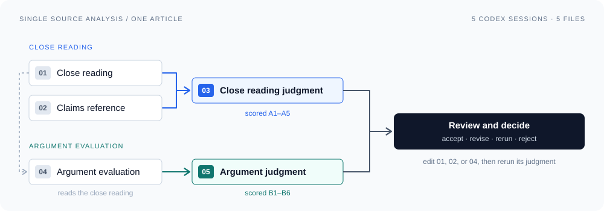

# hitl-research-agent

A human-in-the-loop AI research framework for analyzing sources, evaluating arguments, and synthesizing findings across a research collection. The project investigates how AI can support rigorous research while keeping human judgment and intellectual direction central.

> Can AI meaningfully support rigorous, evidence-grounded research?

The experiment that tests it:

> Does structured source analysis improve downstream research quality compared
> with retrieving original source passages directly?

## Purpose

I’m building this framework to become a better researcher: to work through more literature, make connections across sources, and pursue questions I might otherwise miss. I want AI to help me evaluate the authors’ arguments: whether their evidence supports their claims, whether their methods justify their conclusions, and what assumptions or limitations affect those conclusions.

But before I can rely on AI to judge an argument, I need to judge AI. When using models to summarize and analyze articles, I’ve noticed that they can misattribute claims, leave out important qualifications, or attach evidence that does not support their interpretations. This project therefore evaluates both how faithfully the model represents a source and how well it reasons about the authors’ claims. I need to know whether its assessment helps me understand the argument or gives me errors to correct.

### AI as a research assistant?

The justification to use AI to support research still needs to be made, and that is what this system is for.

> Why use AI when I can read the articles and evaluate the authors' arguments myself?

The AI agents need to add something worthwhile, whether that is helping me compare explanations, noticing conflicting evidence, or identifying an assumption worth investigating. *Does this system help me conduct better research that justifies the time and money spent to build and implement it?* *Will I use it to support my research consistently?*


## Experiment

An open question is whether structured source analysis improves downstream research compared with retrieving passages directly from original documents.

The experiment compares three approaches:

1. **Original documents:** Extract, chunk, embed, and retrieve passages directly from source documents.
2. **Structured analyses:** Retrieve from the close readings, claims references, and argument evaluations (see [Methods](#methods)).
3. **Combined retrieval:** Use both original source passages and structured analyses.

The approaches will be compared across two research case studies, evaluating retrieval quality, source attribution, synthesis accuracy, and the costs of each approach.

The goal is not to assume that additional analysis produces better research. It is to determine whether that analysis provides measurable value, and under what conditions.

## Methods

The framework uses AI to assist with three research activities:

1. **Single-source analysis:** Each source produces three documents:
   - **Close reading:** reconstructs the author's argument step by step, identifying claims, supporting evidence, methods, assumptions, and limitations, without judging it.
   - **Claims reference:** lists the source's own claims, written from the source alone, so the close reading can be checked against it.
   - **Argument evaluation:** the model's own judgment of the argument: whether the evidence supports the claims and the conclusions follow.
2. **Evidence evaluation:** Separate judgments assess whether the close reading accurately represents the source and whether the argument evaluation is justified.
3. **Cross-source synthesis (planned):** Compare findings across a collection to identify agreements, disagreements, gaps, and unanswered questions.

The framework distinguishes what an author states from what the model infers or evaluates. Human review determines which analyses enter the research collection.



## The harness

[`scripts/run_single_source.py`](scripts/run_single_source.py) runs the
single-source analysis for one article:

```bash
uv run python scripts/run_single_source.py <slug>
```

**Why Codex.** The setup was chosen by two A/B experiments, judged as blind
head-to-head tournaments ([details](studies/water/README.md#the-ab-experiments)):

- **Barnett** compared models and inputs. GPT-6.1 Sol at medium effort, reading
  the PDF, won. High effort was no better, a costlier model was about four
  times the price without reading better, and the PDF beat extracted text,
  which had needed manual fixes.
- **Kanbur** compared three ways of running Sol: the API, the ChatGPT app, and
  Codex. Codex won every round, narrowly, and medium beat high in the final.
  The API cost $0.55–0.64 a run, while Codex runs within the ChatGPT plan.

Codex also makes each call a scriptable, isolated session, which is what the
harness needs.

- **Five calls, five files.** Each call (the close reading, the claims
  reference, the close reading judgment, the argument evaluation, and the
  argument judgment) is its own Codex session on GPT-6.1 Sol at medium effort,
  reading the PDF. Each writes one file to the article's folder. It runs
  within the ChatGPT plan, with no API key.
- **Independent sessions.** Each session runs in a temporary folder holding
  only the files that call needs, so the reading never sees its judgment and
  no judge sees another's verdict.
- **The prompts are the requests.** Each call sends its prompt file in
  [`studies/water/prompts/`](studies/water/prompts/) exactly as written, so
  any call can also be run by hand by pasting the same file into a new Codex
  session. The literacy study's prompts are in
  [`studies/literacy/prompts/`](studies/literacy/prompts/).
- **Resumable.** With no option, only the calls whose file is missing run, so
  a stopped run picks up where it left off. `--only 03` reruns one call.
- **Revise in place.** `--revise 01` revises the close reading from its
  judgment, and `--revise 04` the argument evaluation from its judgment; then
  `--only 03` or `--only 05` judges the revision.
- **Only a technical failure stops a run:** Codex exiting with an error or
  timing out, a call's file not written, or a close reading that isn't valid
  JSON. A weak reading is written and judged, never withheld. Codex's event
  log for each call is kept in `.codex_runs/<slug>/`.

The literacy study runs its documents through
[`scripts/workspace.py`](scripts/workspace.py), which loads one source (its
PDF, extracted text, and page images) into a separate Codex workspace and
saves the results back to the study.

## Two studies

| Study | Question | Status |
| --- | --- | --- |
| [**Literacy**](studies/literacy/) | How is the science of reading defined, simplified, and contested as it moves from scholarship, through the popular press, into state legislation? | Legislation trial run done (six laws); scholarly and popular press next |
| [**Water**](studies/water/) | Why does AI infrastructure use freshwater, and when could other cooling methods or water supplies, including desalination, reduce pressure on local freshwater? | Ten articles analyzed and accepted |

The literacy study is a collaboration with a professor of literacy education.
The water study came first and is where the harness was built.

Both studies do the same core work: take the claims out of individual
documents, then compare them across documents. Water compares what sources
claim about one question. Literacy traces how claims change as they travel
between corpora. Each is a test case for the experiment: whether working from
the structured analyses finds and grounds those claims better than retrieving
from the documents themselves.

What we're doing, why, and what's been decided is in
[`docs/PROJECT.md`](docs/PROJECT.md).

## Development approach and lessons

Two coding assistants helped me build this project.

- **Claude Code** is responsible for all of the code.
- **Codex** helps with design and prompt writing.

Neither decides what I research or what the evidence means.

What has been difficult about working this way:

- Each implementation step produced the next step’s problem, and the design
  grew to absorb every one. A safeguard added for one failure became the thing
  the next step had to work around. The accumulated machinery eventually cost
  more than the failures it caught, and removing it took longer than building
  it had.
- The architecture drifted without my deciding it should. No single step chose
  to turn quotation matching into a hard acceptance gate, but it arrived there
  across many small changes that each looked reasonable at the time, and the
  direction was only visible in aggregate.
- The coding assistants did not consistently follow my instructions. I had to repeat requirements, correct assumptions, and undo changes I had not asked for. That took time and money away from the research and made supervising the assistants a substantial part of the work.

## Layout

```
├── docs/
│   ├── PROJECT.md                 the questions, current decisions, and status
│   └── ENGINEERING_DIRECTIVES.md  the coding baseline
├── studies/
│   ├── literacy/                  three corpora, codebooks, rubrics, prompts, results
│   └── water/                     sources, prompts, rubric, accepted analyses
├── scripts/
│   ├── run_single_source.py       water: five Codex calls per article
│   ├── workspace.py               literacy: load a source into the Codex workspace, save its results
│   └── prepare_sources.py         extracts a PDF's text, tables, and figure crops
├── src/hitl_research_agent/       the data models and input handling prepare_sources.py uses
└── tests/
```

Earlier work (the A/B experiments, the decision records, the prompt log, and
the API pipeline) is on the `v2` branch. The literacy study was developed on
the `mom-research` branch, kept as a record.

## Setup and checks

```bash
uv sync
```

```bash
uv run pytest
```

```bash
uv run ruff check . && uv run ruff format --check .
```

```bash
uv run mypy src
```
