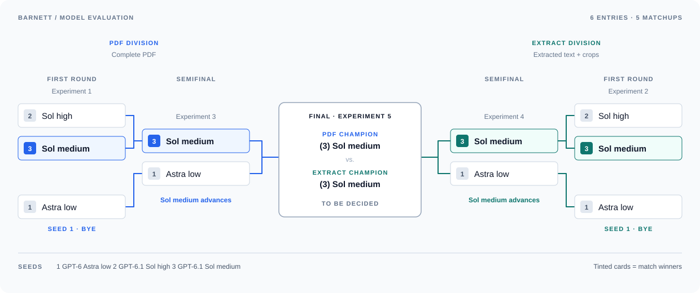
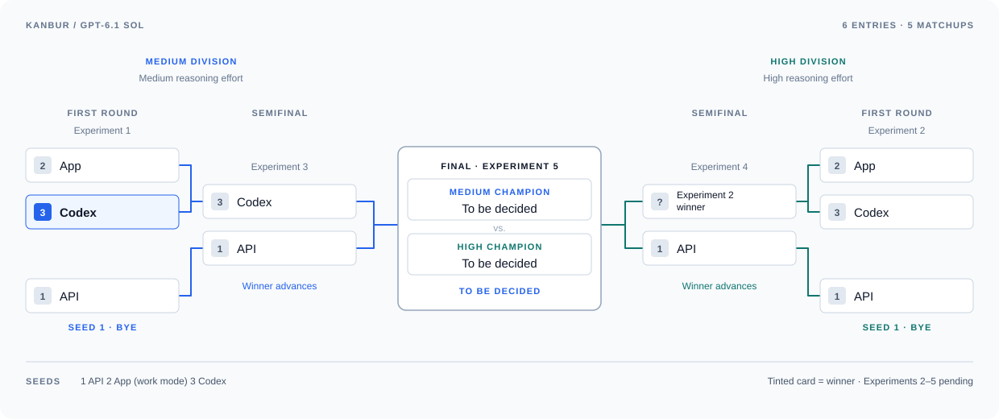

# Evaluation Key

The blind comparisons, results, and costs for Phase 2's two articles:
[**Barnett**](#barnett-tournament-overview) and
[**Kanbur**](#kanbur-tournament-overview).
This key is never given to the judge; model identities, cost, and runtime are
considered afterwards.

## Barnett tournament overview

**Overall winner: GPT-6.1 Sol medium with PDF input.**

Selected from the six Barnett configurations. The final favors PDF for its
cleaner source representation and lack of an extraction/preparation step;
the argument evaluations are treated as tied because the verdict followed
the run letter. This is the overall selection for this experiment, with the
judging limitations described below.

The **PDF** and **Extract** (text and crops) divisions use the same seeds.
In each, Sol high (2) plays Sol medium (3); the winner faces Astra low (1),
which has a bye. The division champions meet in the final.

## Kanbur tournament overview

Kanbur runs the same model, GPT-6.1 Sol, three ways: through the **API**, the
ChatGPT **App** in work mode, and **Codex**. The two divisions are reasoning
efforts, **Medium** and **High**. In each division, App (2) plays Codex (3); the winner faces API (1), which has
a bye. The division champions meet in the final, which answers the effort
question for this article: medium or high.

**Overall winner:** To be decided.

## Barnett results

Sol medium won both divisions, then its PDF run won the final. The overall
winners below account for the detailed findings, cost, preparation, and the
role of close readings in later synthesis—not just the individual verdicts.

| Experiment | Close-reading winner | Evaluation winner | Overall winner |
| --- | --- | --- | --- |
| [1 · PDF first round](#experiment-1--pdf-first-round) | Sol high, narrowly | Sol medium, narrowly | **Sol medium** |
| [2 · Extract first round](#experiment-2--extract-first-round) | Sol high, narrowly | Sol medium, clearly | **Sol medium** |
| [3 · PDF semifinal](#experiment-3--pdf-semifinal) | Sol medium, modestly | Astra low, narrowly | **Sol medium** |
| [4 · Extract semifinal](#experiment-4--extract-semifinal) | Sol medium, modestly | Astra low, narrowly | **Sol medium** |
| [5 · Final](#experiment-5--final) | PDF, narrowly | Tie (followed the letter) | **Sol medium, PDF** |

## Kanbur results

| Experiment | Close-reading winner | Evaluation winner | Overall winner |
| --- | --- | --- | --- |
| [1 · Medium first round](#kanbur-experiment-1--medium-first-round) | Codex, narrowly | Codex, narrowly | **Codex** |
| [2 · High first round](#kanbur-experiment-2--high-first-round) | *to be decided* | *to be decided* | *to be decided* |
| [3 · Medium semifinal](#kanbur-experiment-3--medium-semifinal) | *to be decided* | *to be decided* | *to be decided* |
| [4 · High semifinal](#kanbur-experiment-4--high-semifinal) | *to be decided* | *to be decided* | *to be decided* |
| [5 · Final](#kanbur-experiment-5--final) | *to be decided* | *to be decided* | *to be decided* |

## Barnett judging notes

These are the head-to-head verdicts; disagreements with solo judgments are
noted in the experiment details.

**The verdicts follow the letters.** Every close-reading head-to-head chose
run A, and every evaluation head-to-head chose run B, whichever configuration
was under each letter. Experiment 5's evaluation was run three times, twice
with the PDF as A and once with the letters swapped, and B won all three. The
order check in each session can't catch this, because the judge knows the
letters in both readings. So the verdicts alone don't show that one
configuration is better; each selection rests on cost and on findings
confirmed in the runs themselves, which don't depend on the judge.

Model names are shortened below: Sol is
GPT-6.1 Sol and Astra is GPT-6 Astra. Costs are estimates from reported usage;
[Barnett run records and pricing assumptions](#barnett-run-records) follow Experiment 5.

## Experiment 1 — PDF first round

**Matchup:** (2) Sol high vs. (3) Sol medium.

**Overall winner:** **B — (3) GPT-6.1 Sol medium** — advances to the PDF semifinal

Sol high narrowly wins the close reading; Sol medium narrowly wins the
evaluation. Both verdicts hold in both reading orders. Higher effort does
not produce a consistently better result, and Sol high costs about 16% more.
Phase 3 synthesizes only close readings, which could favor Sol high, but its
edge is narrow and its missing “achievable” claims would enter the claims
store too.

Both runs receive the complete PDF and differ only in reasoning effort.

| Run | Model | Reasoning effort | Close reading | Argument evaluation | Total |
| --- | --- | --- | --- | --- | --- |
| **A** | GPT-6.1 Sol | high | $0.249 · 5 min 24 s | $0.102 · 1 min 16 s | $0.351 |
| **B** | GPT-6.1 Sol | medium | $0.214 · 5 min 2 s | $0.088 · 1 min 3 s | $0.302 |

### Detailed findings

**Close readings: A, narrowly.**

| | A (high) | B (medium) |
| --- | --- | --- |
| A1, solo (30 sampled claims) | 97% at 2, 3% at 1 | 87% at 2, 13% at 1 |
| A1, head to head (15 each, same seed) | 15/15 at 2 | 15/15 at 2 |
| A2, section conclusions (26) | 23 caught, 3 in part | 26 caught |
| A3, strength of language | 1 | 1 |
| A4, mechanical checks | clean | clean |
| Steps · claims | 25 · 135 | 25 · 117 |

Each reading has one weakness that matters, both confirmed in the runs:

- **B drops a scope condition.** In §4.2 the article limits the curtailment
  risk to "once-through or open-loop" cooling. B applies it to all
  natural-water cooling, including the closed-loop systems the section
  describes. A keeps the condition.
- **A leaves out the hopeful half of the thesis.** The article says in §4,
  §5, §6, and the closing that water-sustainable AI is achievable. A records
  none of these as a claim and keeps only the limitation each is paired with.
  B records it in §4 and the closing.

The head-to-head weighed B's scope error more heavily, and found that A
follows the prompt's rules more closely: it records the graphical abstract as
paraphrased support, keeps distinct claims separate, and copies citation
markers as printed. The margin is arguably closer than the head-to-head says:
A's omission is a pattern across the article and concerns half its central
claim, where B's is one error, and the solo coverage counts favor B.

**Argument evaluations: B, narrowly.** Against the 34-problem list, in the
head-to-head:

- **Found only by B:** P3 (limited deployment blamed on policy gaps without
  evidence, Major), P28 (reform concluded necessary without showing
  alternatives fail), P29 (corporate pledges dismissed by assertion), P24
  (two citations that don't fit their claims, Jain 2025 and the aquifer study
  of another basin), and P31 (descriptive evidence to a normative ranking),
  stated more exactly than A.
- **Found only by A:** P21 (data-center figures used as AI figures, Major and
  pervasive), P9, and P12. A also credits the article's disclaimer of
  prohibition, where B's "rationing" drifts toward a position the article
  rejects.
- **Shared:** no factual errors beyond both dropping "U.S." from the §3
  comparison. Neither checks any of the article's numbers, so P13's
  arithmetic is found by neither.

The two solo sessions graded at different strictness: A's counted 9 found and
8 partial, B's 15 found and 4 partial, crediting B with problems the
head-to-head calls partial. The solo counts overstate B's lead; the
head-to-head, reading both in one session, still favors B.

## Experiment 2 — Extract first round

**Matchup:** (2) Sol high vs. (3) Sol medium.

**Overall winner:** **B — (3) GPT-6.1 Sol medium** — advances to the Extract semifinal

Sol high narrowly wins the close reading, but Sol medium clearly wins the
evaluation, finding two Major problems Sol high misses—including the only
number either run checks. Both verdicts hold in both reading orders, and
Sol high costs about 17% more.

Both runs receive extracted text and figure/table crops and differ only in
reasoning effort.

| Run | Model | Reasoning effort | Close reading | Argument evaluation | Total |
| --- | --- | --- | --- | --- | --- |
| **A** | GPT-6.1 Sol | high | $0.239 · 5 min 23 s | $0.091 · 1 min 12 s | $0.330 |
| **B** | GPT-6.1 Sol | medium | $0.206 · 4 min 36 s | $0.077 · 48 s | $0.282 |

### Detailed findings

**Close readings: A, narrowly.**

| | A (high) | B (medium) |
| --- | --- | --- |
| A1, solo (30 sampled claims) | 90% at 2, 10% at 1 | 83% at 2, 17% at 1 |
| A1, head to head (every item) | no 0s, 1 claim at 1 | 1 claim at 0, 3 at 1 |
| A2, section conclusions (26) | 25 caught, 1 in part | 25 caught, 1 in part |
| A3, strength of language | 2 (borderline 1) | 1 |
| A4, verbatim · references | 11/11 · 65/66 | 16/17 · 64/64 |
| Steps · claims | 23 · 133 | 26 · 109 |

Each reading has faults the other doesn't, all confirmed in the runs:

- **B marks a cut sentence `verbatim`.** "Digital water sobriety challenges the
  assumption…" drops the author's "analogous to frameworks in climate and
  energy policy" with no ellipsis, the only 0 in either reading. A records the
  same sentence as paraphrased.
- **B drops the scope condition on the curtailment risk again.** Its claim
  applies the risk to all natural-water cooling; the article limits it to
  "once-through or open-loop" systems. A keeps the condition. B made the same
  error in Experiment 1.
- **A drops an author from a reference entry.** Its Pfister et al. (2017) entry
  leaves out "Döll, P."; B's includes him.
- **A files a duplicated §2 claim under §3,** and fills about a dozen support
  items with its own description of how the argument links up, once
  strengthening the author ("decisive").

A also keeps H3's "limited by policy gaps" and CO12's EIA analogy, which B
misses; B keeps the condition on the 2027 projection ("If this increase in AI
use continues"), which A drops, and follows the article's breaks more closely.
The head-to-head decided on A1, where only B has a 0.

**Argument evaluations: B, by a clear margin.** Against the 34-problem list:

- **Found only by B:** P13, the article's one checkable arithmetic error (1 MW
  at 2 L/kWh is 17,520 m³ a year, not 25,500; confirmed), and P21,
  data-center figures used as AI figures. Both are Major. B also finds P8 (the
  urgency argument from unfamiliarity with a term, which is self-cited) and
  partly P3.
- **Found only by A:** P16 (Table 1's per-MW values with no capacity
  denominator) and partly P29, plus sharper versions of P6, P7, and P31
  that both runs found.
- **Shared:** no factual errors in either. A has two slight overreaches
  (disclosure metrics, replenishment) that B doesn't. Both praise §3's scale
  comparison without seeing that it sets U.S. consumption against global
  withdrawals (P15).

The solo sessions agree: B touches all nine Major problems and misses none,
while A misses P13 and P21. Solo totals are close (A 9 found and 7 partial, B
10 and 7) because A's finds sit in Moderate and Minor problems.

**Implications for later comparisons.**

- B's dropped open-loop condition appears with both input methods, so it
  looks like a habit of Sol medium rather than an accident of one run.
- Both runs here describe artifacts of the prepared text as if they were the
  article: a "displaced" §2 sentence, and Table 1 as an image when it is
  printed as text. Neither reads the graphical abstract, which both PDF runs
  in Experiment 1 at least described. This bears on Experiment 5's
  input-method question.

## Experiment 3 — PDF semifinal

**Matchup:** (3) Sol medium vs. (1) Astra low.

**Overall winner:** **A — (3) GPT-6.1 Sol medium** — PDF division champion, advances to the final

Sol medium wins the close reading by a modest margin; Astra low narrowly
wins the evaluation. Both verdicts hold in both reading orders. Astra costs
4.3 times as much ($1.293 vs. $0.302), and its evaluation edge is too small
to justify that premium. Phase 3 synthesizes only close readings, where Sol
medium leads; the judge says the evaluations could reasonably be seen as
close to even.

Sol medium reuses Experiment 1’s winning PDF run (B).

| Run | Model | Reasoning effort | Close reading | Argument evaluation | Total |
| --- | --- | --- | --- | --- | --- |
| **A** | GPT-6.1 Sol (winner of Experiment 1) | medium | $0.214 · 5 min 2 s | $0.088 · 1 min 3 s | $0.302 |
| **B** | GPT-6 Astra | low | $0.892 · 3 min 30 s | $0.401 · 38 s | $1.293 |

### Detailed findings

**Close readings: A, by a modest margin.**

| | A (Sol medium) | B (Astra low) |
| --- | --- | --- |
| A1, solo (30 sampled claims) | 90% at 2, 10% at 1 | 83% at 2, 17% at 1 |
| A2, section conclusions (26) | 25 caught, 1 in part | 24 caught, 2 in part |
| A3, strength of language | 1 | 1 |
| A4, verbatim · numbers · references | 13/13 · 97/97 · 64/64 | 5/5 · 91/91 · 53/53 |
| Steps · claims | 25 · 117 | 21 · 93 |

- **A drops the scope condition on the curtailment risk,** the same error as
  in Experiment 1: it applies the risk to all natural-water cooling, where the
  article limits it to "once-through or open-loop" systems. B keeps the
  condition. This is A's only substantive alteration.
- **B has three smaller alterations, all confirmed in the runs.** It drops
  "capacity for" from Hainan's 400–800 servers, so a capacity reads as a
  deployed count. It turns Colón's "raise… environmental justice dimensions"
  into an asserted injustice. And it files the uncited Lule River hydropower
  figure under the Zhang (2024) citation.
- **B compresses Table 1,** one of the article's six stated contributions. It
  records the WUE and consumption values but leaves out the example-facility
  and trade-off columns. It is also partial on §4.1's Nordic conclusion (CO22)
  and the abstract's list of four technologies (AB5). A reads all of these in
  full.
- **B merges distinct claims more often,** against the prompt, and quotes
  `verbatim` less (5 quotes against A's 13). B catches H3's "limited by policy
  gaps", which A misses.

**Argument evaluations: B, narrowly.** Against the 34-problem list:

- **Found only by B:** P13, the 25,500 m³ arithmetic (Major, worked correctly;
  confirmed), and P9, tying application-level governance to the article's own
  §6.1 admission that the accounting doesn't exist. B also argues P1–P3 from
  §4's own constraints, where A states the same verdict without the
  derivation.
- **Found only by A:** P5 (the §4.5 heat-recovery hedge dropped in §6.2), P15
  in a concrete passage (Luleå's withdrawal figure reused as "suffices for
  hyperscale"), and a second citation mismatch (the aquifer study of another
  basin). A also partly touches P14 and P21, which B misses.
- **Relevance:** A again describes the framework as "rationing" and
  "officials classifying every application", where the article rejects
  binary bans. B credits that qualifier and shows why its objection survives
  it. B2: B at 2, A at 1.
- **Shared:** no factual errors in either. Neither fully finds P21
  (data-center figures used as AI figures).

The solo counts agree: B finds 6 of the 9 Major problems and partly finds 1;
A finds 4 and partly finds 3.

**Implications for later comparisons.**

- Sol medium's dropped open-loop condition is in both of its close readings,
  PDF and text, and every session that judged them found it. Expect it in
  Experiment 4.
- Sol medium's evaluation lost B2 points here for the "rationing" framing, the
  same drift noted in Experiment 1.

## Experiment 4 — Extract semifinal

**Matchup:** (3) Sol medium vs. (1) Astra low.

**Overall winner:** **A — (3) GPT-6.1 Sol medium** — Extract division champion, advances to the final

Sol medium wins the close reading by a modest margin; Astra low narrowly
wins the evaluation. Both verdicts hold in both reading orders. Astra costs
4.2 times as much ($1.172 vs. $0.282), and its thin evaluation edge is not
supported by the solo judgments.

Sol medium reuses Experiment 2’s winning Extract run (B).

| Run | Model | Reasoning effort | Close reading | Argument evaluation | Total |
| --- | --- | --- | --- | --- | --- |
| **A** | GPT-6.1 Sol (winner of Experiment 2) | medium | $0.206 · 4 min 36 s | $0.077 · 48 s | $0.282 |
| **B** | GPT-6 Astra | low | $0.823 · 3 min 28 s | $0.348 · 55 s | $1.172 |

### Detailed findings

**Close readings: A, by a modest margin.**

| | A (Sol medium) | B (Astra low) |
| --- | --- | --- |
| A1, solo (30 sampled claims) | 93% at 2, 7% at 1 | 93% at 2, 7% at 1 |
| A2, section conclusions (26) | 26 caught | 24 caught, 2 in part |
| A3, strength of language | 1 | 2 |
| A4, verbatim · numbers · references | 16/17 · 101/101 · 64/64 | 7/7 · 91/91 · 53/53 |
| Steps · claims | 26 · 109 | 20 · 84 |

- **A repeats its two known faults.** It drops the "once-through or
  open-loop" condition on the curtailment risk, though its support item
  restores it, and it marks the cut "Digital water sobriety challenges…"
  sentence `verbatim`. It also attaches the Yañez-Barnuevo citation to the
  whole footprint where the article attaches it to the wafer figure.
- **B keeps the open-loop condition but loses the article's close.** It has
  no claim for §6.3's "policy and siting choices, not technological
  necessity" (CO19), keeps only the last sentence of the Colón diagnosis
  (CO20), and attaches the Luleå and subsea contrast to the Colón verdict
  instead. Confirmed in the run.
- **B's own alterations:** it drops "Projections suggest" from the abstract's
  projection, and turns Colón's "raise… environmental justice dimensions"
  into "create environmental-justice failures" (confirmed), the same
  strengthening Astra made with the PDF in Experiment 3.
- **B merges distinct claims,** including §3.1 and §3.2 into one step past the
  prompt's pace. B catches H3's "limited by policy gaps" and the fifth
  research priority, which A misses.

The solo sessions are closer than the head-to-head: both readings score 93%
at 2 on A1, and the solo session put Astra at 2 on A3 and Sol medium at 1.
The head-to-head decided on coverage of the article's closing conclusions.

**Argument evaluations: B, narrowly.** Against the 34-problem list:

- **Found only by B:** P16 (Table 1's values without a capacity
  denominator), P18 (the dropped "or planned"), P24 (the Jain citation), P12,
  and P29, plus fuller versions of P5, P27, and P31.
- **Found only by A:** P21 (data-center figures used as AI figures) and P3
  (policy assumed to be the barrier), both Major, plus P8 and the measurement
  half of P9.
- **Shared:** both work P13's arithmetic correctly (17,520 m³). No factual
  errors in either. Both praise §3's scale comparison without seeing that it
  sets U.S. consumption against global withdrawals.

The judge calls the margin thin and resting on breadth more than severity:
B finds more listed problems, A finds more Major ones, and weighing only Major
problems would make them even. The solo sessions lean the other way: A's
found all nine Major problems at least in part and scored 2 on B2, while
B's missed P3 and scored 1 on B2.

**Implications for later comparisons.**

- Experiment 5 compares two runs whose faults are now well documented: Sol
  medium's PDF reading (Experiments 1 and 3) and its text reading
  (Experiments 2 and 4). Both drop the open-loop condition, so that error
  won't separate them.
- Both readings in this experiment again describe artifacts of the prepared
  text as the article's: the split §2 method passage, and neither reads the
  graphical abstract.

## Experiment 5 — Final

**Matchup:** PDF champion vs. Extract champion: Sol medium on the PDF vs. Sol
medium on extracted text and crops.

**Overall winner:** **A — GPT-6.1 Sol medium, PDF** — champion

The PDF narrowly wins the close reading; the evaluation is a tie, since its
verdict went to whichever run was B. The extracted text is 7% cheaper per run
($0.282 vs. $0.302) but needs a preparation step, and it leaves artifacts of
that preparation in the reading. The PDF reading has none of them, and close
readings are what Phase 3's synthesis uses.

Same model, same effort, same instructions: only the input differs. Both runs
were judged alone in earlier experiments (the PDF run in Experiments 1 and 3,
the text run in 2 and 4), so this experiment has only the two head-to-heads.

| Run | Configuration | Input | Total |
| --- | --- | --- | --- |
| **A** | GPT-6.1 Sol medium (winner of Experiment 3) | PDF | $0.302 |
| **B** | GPT-6.1 Sol medium (winner of Experiment 4) | extracted text and crops | $0.282 |

### Detailed findings

**Close readings: A (PDF), narrowly.** The judge read every claim in both
runs, not a sample.

| | A (PDF) | B (text) |
| --- | --- | --- |
| A1, every claim | no 0s, about four at 1 | one 0, about three at 1 |
| A2, coverage | everything on the list; graphical abstract in `meaning` | everything but the graphical abstract; one research priority only in `meaning` |
| A3, strength of language | 1 | 1, closer to 2 |
| A4, verbatim · numbers · references | 13/13 · 97/97 · 64/64, clean | 16/17 · 101/101 · 64/64, damaged markers |
| Steps · claims | 25 · 117 | 26 · 109 |

- **B carries artifacts of its prepared input, all confirmed in the run.**
  Three citation markers hold extraction debris ("(Holzle, ¨ 2022)",
  "(Yanez-Barnuevo, 2025˜ )"), where A prints "Hölzle" correctly. Table 1's
  support items say "gap T1" and "read from the retained image", though the
  table is printed as text. Its reading plan describes an "interrupted
  methodological passage" the PDF doesn't have, and that misplaces one §2
  claim. And B never mentions the graphical abstract.
- **B marks the cut "Digital water sobriety challenges…" sentence `verbatim`,**
  the only 0 in either reading, the same fault found in Experiments 2 and 4.
- **A softens or strengthens §4.2.** It drops the "once-through or open-loop"
  condition from the curtailment claim, turns "raise ecological questions"
  into "can coexist with", and drops "if widely scaled". B keeps all three,
  and keeps the condition on the §1 projection. These are A's known faults
  from Experiments 1 and 3.

The judge chose A because B's faults include a misquotation and a misdescribed
location, where A's are fixable shifts in qualifiers, and called the margin
small enough that weighing A3 first could favor B. A was the letter every
close-reading head-to-head chose, and this one wasn't rerun with the letters
swapped. The input artifacts above don't depend on that verdict.

**Argument evaluations: a tie.** The evaluation head-to-head was run three
times; only the first is kept in the judgments folder.

| Session | A | B | Verdict |
| --- | --- | --- | --- |
| 1 (kept) | PDF | text | **B**, modest margin |
| 2 | PDF | text | **B**, narrowly |
| 3 | text | PDF | **B**, narrowly |

The three sessions agree on what each evaluation found and differ only on how
much it counts:

- **Found only by the text run:** P13 (the 25,500 m³ arithmetic) and P21
  (data-center figures used as AI figures), both Major, plus P8 and P9.
- **Found only by the PDF run:** P16 (Table 1's values without a capacity
  denominator), P23 (the unreproducible method and source mix), P24 (two
  misfitting citations), and P29, plus P5 tied to §4.5's own caveat.
- **Relevance:** the PDF run again calls the framework "rationing", which the
  article rejects; the text run engages its graduated form.
- **Shared:** no factual errors in either.

These are the same two evaluations judged in Experiments 1–4, and the same
finds were credited to them there.

**Bottom line.** With the evaluations tied and the close readings close, the
input decides it on what the judge can't sway: the prepared text needs a
preparation step that took manual fixes in Phase 1, it costs the reading
accuracy about the article itself (its layout, its markers, its graphical
abstract), and it saves $0.02 a run. The PDF wins.

## Barnett run records

### Pricing assumptions

Costs are calculated from the usage each run reported, per million tokens:
GPT-6.1 Sol at $2.00 input and $10.00 output, GPT-6 Astra at $10.00 input and
$50.00 output. They aren't confirmed billing.

### Shared setup and run IDs

Experiment 1 writes Barnett's reference lists, `claims_reference.md` and
`problems_reference.md`, kept once in `outputs/judgments/barnett/references/`. Experiments
2–5 copy them in and judge against the same lists. Each experiment's own folder
under `barnett/` holds only its six judgments.

All of Barnett's runs come from
`outputs/ab_testing/barnett_itzhaki_2026_water_footprint_artificial_intelligence/adr_0013/`
and used the same instructions.

Each judgment records the `id` at the top of the file it judged. Check it
against this table to confirm the right file went under each letter. The ids
say nothing about how a run was made, so they stay blind.

| Run folder | `analysis.json` id | Argument evaluation id |
| --- | --- | --- |
| `pdf__gpt-6.1-sol-high/` | `bee567c1-d264-4806-a1f7-40a5bb43e01c` | `5b3c4998-8652-4bb3-aeb1-e651b988dd16` |
| `pdf__gpt-6.1-sol-medium/` | `b52aa04e-d9f7-4e11-8e78-fbab1dd1da59` | `b35af235-25d9-4f75-897a-3a2b33ac6625` (`argument_evaluation_2.json`) |
| `pdf__gpt-6-astra-low/` | `58057f58-eb36-44ca-bdc6-f8a84ac4f6a6` | `5ec263ff-886b-4a8b-bf36-a2f967ffbdf3` |
| `text_crops__gpt-6.1-sol-high/` | `56377890-9bfb-469c-8786-ece6a6ea5348` | `21ca21e5-73fa-4d0c-a75a-0d9f9171417f` |
| `text_crops__gpt-6.1-sol-medium/` | `182e2233-37de-4fde-b637-d787f5cc0fef` | `77671eb8-5439-4e76-9125-78ebd96dba09` |
| `text_crops__gpt-6-astra-low/` | `cb4cc7f2-e7a3-4b12-862c-4db104ab494a` | `52123ee9-3f08-4980-8a3d-7b5e9b27b204` |

### Experiment 1 records

Judgments: `outputs/judgments/barnett/exp1_barnett_pdf_sol_high_vs_medium/`

**Sources and letter assignments**

- A — `pdf__gpt-6.1-sol-high/`: `analysis.json` and
  `argument_evaluation.json`, from the rerun recorded in
  `argument_evaluation_rerun_record.json`.
- B — `pdf__gpt-6.1-sol-medium/`: `analysis.json` and
  `argument_evaluation_2.json`, copied as `argument_evaluation.json`. Its first
  evaluation was written under an earlier prompt and isn't judged.

**Token usage**

| Run | Input tokens | Output tokens | Reasoning tokens |
| --- | --- | --- | --- |
| **A** close reading | 18,479 | 21,158 | 1,552 |
| **A** evaluation | 36,665 | 2,892 | 1,034 |
| **B** close reading | 18,479 | 17,678 | 249 |
| **B** evaluation | 34,488 | 1,925 | 85 |

### Experiment 2 records

Judgments: `outputs/judgments/barnett/exp2_barnett_text_crops_sol_high_vs_medium/`

**Sources and letter assignments**

- A — `text_crops__gpt-6.1-sol-high/`: `analysis.json` and
  `argument_evaluation.json`.
- B — `text_crops__gpt-6.1-sol-medium/`: `analysis.json` and
  `argument_evaluation.json`.

**Token usage**

| Run | Input tokens | Output tokens | Reasoning tokens |
| --- | --- | --- | --- |
| **A** close reading | 12,992 | 21,659 | 2,031 |
| **A** evaluation | 31,201 | 2,832 | 1,034 |
| **B** close reading | 12,992 | 17,985 | 516 |
| **B** evaluation | 29,042 | 1,850 | 79 |

### Experiment 3 records

Judgments: `outputs/judgments/barnett/exp3_barnett_pdf_winner_vs_astra_low/`

**Sources and letter assignments**

- A — `pdf__gpt-6.1-sol-medium/`: `analysis.json` and
  `argument_evaluation_2.json`, copied as `argument_evaluation.json`, the same
  files as Experiment 1's B.
- B — `pdf__gpt-6-astra-low/`: `analysis.json` and `argument_evaluation.json`.

**Token usage**

GPT-6 Astra low's tokens: close reading 18,479 input, 14,145 output, 41
reasoning; evaluation 31,163 input, 1,794 output, 17 reasoning.

### Experiment 4 records

Judgments: `outputs/judgments/barnett/exp4_barnett_text_crops_winner_vs_astra_low/`

**Sources and letter assignments**

- A — `text_crops__gpt-6.1-sol-medium/`: `analysis.json` and
  `argument_evaluation.json`, the same files as Experiment 2's B.
- B — `text_crops__gpt-6-astra-low/`: `analysis.json` and
  `argument_evaluation.json`.

**Token usage**

GPT-6 Astra low's tokens: close reading 12,992 input, 14,199 output, 92
reasoning; evaluation 25,680 input, 1,826 output, 45 reasoning.

### Experiment 5 records

Judgments: `outputs/judgments/barnett/exp5_barnett_pdf_vs_text_crops/`

**Sources and letter assignments**

- A — `pdf__gpt-6.1-sol-medium/`: `analysis.json` and
  `argument_evaluation_2.json`, copied as `argument_evaluation.json`, the same
  files as Experiment 1's B and Experiment 3's A.
- B — `text_crops__gpt-6.1-sol-medium/`: `analysis.json` and
  `argument_evaluation.json`, the same files as Experiment 2's B and
  Experiment 4's A.

---

## Kanbur judging setup

All runs read the PDF. The question across the tournament, from
[ADR-0017](adr/0017-experiment-2-api-against-the-app-with-the-primer.md) and
[ADR-0020](adr/0020-codex-joins-experiment-2.md), is whether the API adds
anything over the App and Codex, which report no per-run cost.

Kanbur has no full set of researcher notes, so its reference lists are written
fresh in Experiment 1 (prompts 1 and 5) and reused in Experiments 2–5. The
judging follows Barnett's in Experiments 1–4, six judgments each. Barnett's
head-to-head verdicts followed the letters, so Experiment 5 runs each of its
two head-to-heads twice, with the letters swapped the second time: 4
judgments there, 28 in all.

## Kanbur experiment 1 — Medium first round

**Matchup:** (2) App vs. (3) Codex, both at medium effort.

**Overall winner:** **B — (3) Codex, medium** — advances to the Medium semifinal

Codex narrowly wins both the close reading and the evaluation. Both
head-to-head verdicts hold in both reading orders. Neither run reports a
cost, so the findings decide it. Codex reads every figure, where the App
names four without saying what they show. Its evaluation adds two problems
the App's misses and makes no factual error, where the App's misreads
Table 2's pump price. The App's advantages are narrower: it keeps the
abstract's "for real applications" and finds P5, a Major problem Codex
misses.

Both runs read the complete PDF at medium effort and differ only in how
they were run.

| Run | Configuration | Close reading | Argument evaluation |
| --- | --- | --- | --- |
| **A** | App, work mode, medium | not reported | not reported |
| **B** | Codex, medium | about 7–8 min | about 3 min |

### Detailed findings

**Close readings: B, narrowly.**

| | A (App) | B (Codex) |
| --- | --- | --- |
| A1, solo (30 sampled claims) | 97% at 2, 3% at 1 | 97% at 2, 3% at 1 |
| A2, contributions (4) | 3 caught, 1 in part | 4 caught, 1 reframed |
| A2, abstract claims (12) | 11 caught | 9 caught, 1 in part, 2 missed |
| A2, figures (10) | 7 read, 3 named only | 9 read, 1 named only |
| A3, strength of language | solo 2, head to head 1 | 1 |
| A4, verbatim · numbers · references | 2/2 · 311/311 · 47/47 | 0/0 · 318/318 · 47/47 |
| Steps · claims | 46 · 147 | 36 · 151 |

Each reading has faults the other doesn't, all confirmed in the runs:

- **A changes Table 1's units.** Its support says the heat-flux columns are
  "in W/m²"; the table prints "W/m²K". That's a silent correction the
  prompt forbids. A also drops the literature gap's "as far as we know".
- **A reads fewer figures.** For Figures 4 and 10 it gives only what they
  plot, not what they show; the trends in its claims come from the prose.
  B reads every figure but Figure 3, and its readings agree with the
  reference list's by-eye checks, including Figure 8's slight rise with
  area.
- **B drops the abstract's scope.** "Economically feasible for real
  applications" becomes "evidence of economic feasibility", so the shift
  to the Conclusion's "for further real-scale demonstrations" is lost. A
  keeps it. B also changes contribution (b): the article's "new alternative
  to the data center cooling systems" becomes "a new clean-water-producing
  alternative".
- **B keeps more of what the article prints.** It records both halves of
  the self-contradictory GOR/PR sentence, Table 3's printed "c3 = u3", and
  "the PP is assumed constant". A smooths the GOR/PR sentence and misses the
  other two.

A also gives every Table 1 value, where B gives only the differences, and
catches AB1 and AB6, which B misses. The head-to-head decided on figure
readings and contributions, which are whole categories, against A's
specific items. The solo sessions are closer: the same A1 score, and A at 2
on A3 where B is at 1.

**Argument evaluations: B, narrowly.** Against the 23-problem list:

- **Found only by B:** P8 (chemical exergy dropped in a desalination
  system) and P7 (SI read as evidence of sustainability). B also gives
  fuller versions of P2 (the flat payback against a fifteenfold change in
  water output) and P4: since flux doesn't depend on area, Eq. 24 would
  rise with area, while Figure 5B falls. That rules out Eq. 24 as the
  quantity computed.
- **Found only by A:** P5 (the text puts the GOR and PR peaks at the
  smallest area, against Eqs. 22–23), a Major problem. A also turns P1's
  revenue gap into a payback of about 980 years.
- **Errors:** A writes "Table 2 lists a pump price of SGD 950" for one
  added pump; the row is "Feed and permeate pumps", one price for both. So
  its 980 years is about twice too high. A hedges this, and its conclusion
  stands either way. B has no errors.
- **Shared:** P1, P3, P13 and P22, and P16 in part. Neither finds P10
  (levelized costs far above the cost inputs), the other Major problem.

The solo sessions agree on the shape: each run finds 5 of the 7 Major
problems; A has 7 found and 3 partial, B 8 found and 3 partial.

**Implications for later comparisons.**

- Barnett's close-reading head-to-heads always chose A. This one chose B,
  so that verdict isn't simply the letter. The evaluation verdict went to B,
  as every Barnett evaluation did, so it rests on the findings above.
- B's dropped "for real applications" is the same kind of fault as Sol
  medium's dropped open-loop condition in Barnett: a scope condition lost
  from a headline claim. Watch for it in Experiment 3.

## Kanbur experiment 2 — High first round

**Matchup:** (2) App vs. (3) Codex, both at high effort.

**Overall winner:** *to be decided*

| Run | Configuration | Close reading | Argument evaluation |
| --- | --- | --- | --- |
| **?** | App, work mode, high | not reported | not reported |
| **?** | Codex, high | about 7–8 min | about 3 min |

## Kanbur experiment 3 — Medium semifinal

**Matchup:** winner of Experiment 1 vs. (1) API, at medium effort.

**Overall winner:** *to be decided*

| Run | Configuration | Close reading | Argument evaluation | Total |
| --- | --- | --- | --- | --- |
| **?** | Codex, medium (winner of Experiment 1) | about 7–8 min | about 3 min | not reported |
| **?** | API, medium | $0.349 · 3 min 31 s | $0.202 · 52 s | $0.551 |

## Kanbur experiment 4 — High semifinal

**Matchup:** winner of Experiment 2 vs. (1) API, at high effort.

**Overall winner:** *to be decided*

| Run | Configuration | Close reading | Argument evaluation | Total |
| --- | --- | --- | --- | --- |
| **?** | winner of Experiment 2 | | | |
| **?** | API, high | $0.400 · 6 min 2 s | $0.243 · 2 min 28 s | $0.643 |

## Kanbur experiment 5 — Final

**Matchup:** Medium champion vs. High champion.

**Overall winner:** *to be decided*

Both runs were judged alone in Experiments 3 and 4, so this experiment has
only the head-to-heads, each run in two sessions with the letters swapped.

| Session | A | B | Close reading | Evaluation |
| --- | --- | --- | --- | --- |
| 1 | Medium champion | High champion | | |
| 2 | High champion | Medium champion | | |

A configuration wins a head-to-head only if it wins both sessions. If the
sessions split, each verdict followed its letter, and the head-to-head is a
tie, decided on the findings both sessions confirm in the runs.

## Kanbur run records

### Cost and usage

Only the API reports usage. Its costs use the same GPT-6.1 Sol rates as
Barnett's. The App reports nothing. Codex, on the ChatGPT Pro plan, reports no
tokens: its four sessions took the times above and used about 1% of the weekly
limit. The API runs also wrote a primer, which isn't judged and isn't in these
costs.

| API run | Input tokens | Output tokens | Reasoning tokens |
| --- | --- | --- | --- |
| Medium close reading | 72,234 | 20,466 | 283 |
| Medium evaluation | 90,992 | 2,012 | 120 |
| High close reading | 72,234 | 25,545 | 1,988 |
| High evaluation | 94,366 | 5,449 | 3,624 |

### Shared setup and run sources

The article is `data/research/ab_testing/kanbur_et_al_2020_desalination_integrated_data_center_cooling.pdf`.
All runs are in
`outputs/ab_testing/kanbur_et_al_2020_desalination_integrated_data_center_cooling/`.
Judgments go in `outputs/judgments/kanbur/`, with the reference lists in
`references/` and each experiment's judgments in its own folder.

The runs came out in different shapes. The API's files are JSON with an id and
a provenance block, while the App's and Codex's are a bare `analysis.json` with
no id and an `argument_evaluation.md`. Side by side, a judge could tell the API
run apart and couldn't record an id for the others. So the judging folders use
uniform copies in `outputs/judgments/kanbur/runs/<configuration>/`: each run
as `analysis.json` (`id` and `content`) and `argument_evaluation.json` (`id`,
`analysis_id`, and `content.evaluation`), with no provenance. The API copies
keep their original ids; the App and Codex copies have ids assigned here. The
content is unchanged, and the originals are untouched.

| Copy | Original | `analysis.json` id | Argument evaluation id |
| --- | --- | --- | --- |
| `runs/api_medium/` | `adr_0017/pdf__gpt-6.1-sol-medium/` | `7f044bce-0cae-4472-a887-d01646c0092e` | `9d417ada-ee4c-4172-9a85-9dd108361e4f` |
| `runs/api_high/` | `adr_0017/pdf__gpt-6.1-sol-high/` | `2a82aff3-14e1-4c82-a830-1c9118ce5847` | `e5f3697e-2fdd-4056-9060-e9bb430465d0` |
| `runs/app_medium/` | `adr_0017/app__gpt-6.1-sol-medium-work/` | `5698e6b9-8d5f-4379-84d8-875a9247895c` | `279c062d-f752-4114-bf60-dcc9e9d058f0` |
| `runs/app_high/` | `adr_0017/app__gpt-6.1-sol-high-work/` | `b050b54f-75ac-4a51-be4e-eceacaea58e8` | `354aac17-6f8d-4355-8ab3-74e9ca6841da` |
| `runs/codex_medium/` | `adr_0020/codex__gpt-6.1-sol-medium/` | `3686ad7a-7dc2-4c56-a379-39e00b79c243` | `8dd71213-5808-4dd1-adf8-9191fe4640c0` |
| `runs/codex_high/` | `adr_0020/codex__gpt-6.1-sol-high/` | `fa401e5e-ea12-498b-9ccb-24aa8aa410fa` | `dd922c0a-e4a0-40f2-a411-13b0a541f3fe` |

### Setting up a kanbur judging folder

1. Copy in `RUBRIC.md`, `prompts/`, and the article as `article.pdf`.
2. For each letter, copy the run's two files, `analysis.json` and
   `argument_evaluation.json`, from `outputs/judgments/kanbur/runs/<configuration>/`
   into `runs/A/` or `runs/B/`. Copy only the files: the copies' folder names
   say which configuration they are.
3. Never copy Codex's `run_note.md`. It says how Codex read the PDF and names
   its configuration.
4. **Experiment 1:** start with an empty `references/` and run all eight
   prompts; prompts 1 and 5 write kanbur's reference lists. Copy
   `references/` back to `outputs/judgments/kanbur/references/`.
5. **Experiments 2–4:** copy `outputs/judgments/kanbur/references/` in as
   `references/`, skip prompts 1 and 5, and run the other six.
6. **Experiment 5:** both runs were judged alone in Experiments 3 and 4, so
   run only prompts 4 and 8, the two head-to-heads, in two sessions. Session
   1 puts the Medium champion under A; session 2 swaps the letters. Name each
   judgment by its session: `close_reading_head_to_head_1.md` and `_2.md`,
   `evaluation_head_to_head_1.md` and `_2.md`.
7. Record the letters in this key, and check the ids each judgment records
   against the table above.
8. Copy only `judgments/` back, into the experiment's folder below.

| Experiment | Judgments folder |
| --- | --- |
| 1 | `outputs/judgments/kanbur/exp1_kanbur_medium_app_vs_codex/` |
| 2 | `outputs/judgments/kanbur/exp2_kanbur_high_app_vs_codex/` |
| 3 | `outputs/judgments/kanbur/exp3_kanbur_medium_winner_vs_api/` |
| 4 | `outputs/judgments/kanbur/exp4_kanbur_high_winner_vs_api/` |
| 5 | `outputs/judgments/kanbur/exp5_kanbur_medium_vs_high/` |
