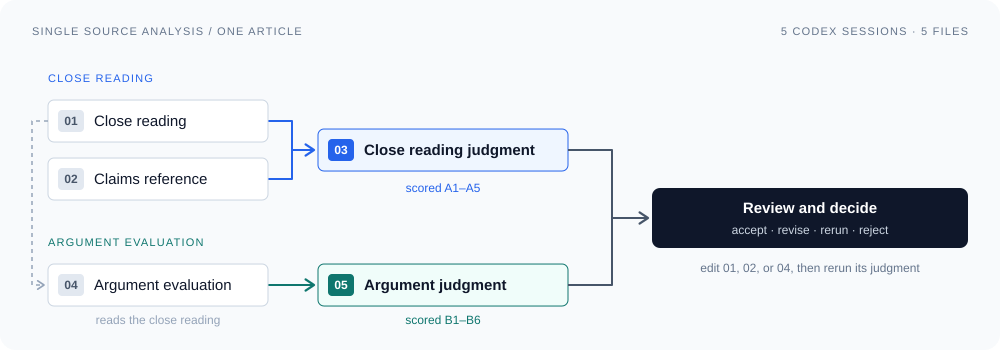
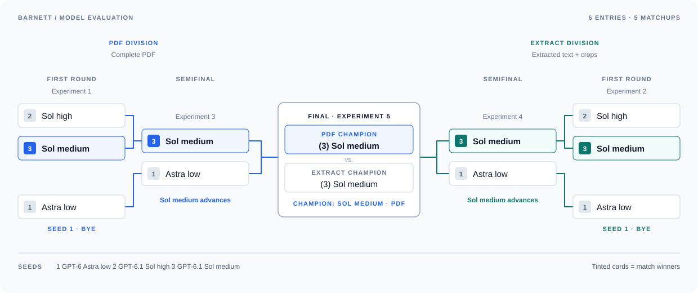
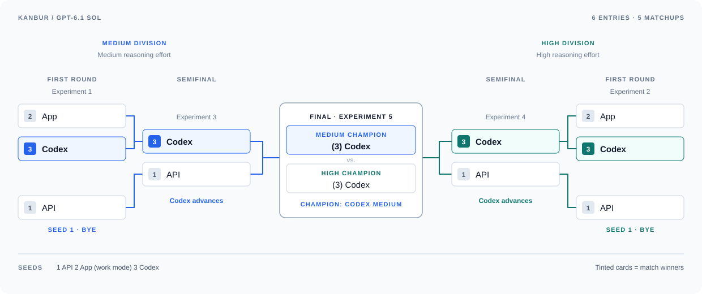

# Water study

> Why does AI infrastructure use freshwater, and under what conditions could
> alternative cooling methods or water supplies, including desalination, reduce
> pressure on local freshwater resources?

The investigation distinguishes freshwater, drinking-quality water, and water
suitable for a particular process, and examines desalination as a possible
supply option rather than assuming it is the preferred one. These distinctions
matter for relevance: a source about process-grade cooling water is not
evidence about drinking water, and treating them as the same thing is the first
way a judgment about relevance goes wrong.

The collection has 10 articles, in [`data/`](data/). Two of them, Barnett
and kanbur, were also the A/B experiment set. Seven PDFs are
included because their licenses allow sharing (open access or US government
work). Barnett-Itzhaki, Katakam, and Kanbur are publisher-copyrighted, so
their PDFs aren't in the repository; their DOIs are in
[`sources.yaml`](data/sources.yaml).

I collected the articles for this pilot study myself, using the research question to identify relevant sources. For finding articles later, I plan to pilot Consensus, a tool built for that work. Nothing in this system receives the research question, so its outputs can support other research questions as the collection grows.

## Design

### Two readings

Recording what an author says and judging whether the argument holds pull in
opposite directions: one asks the model to keep its view out, the other asks
for its view. When Barnett's early runs asked for both in one prompt, the
evaluation crowded out the claims, so they are two calls with two prompts.

**The close reading** is asked to follow the article from start to finish in
steps of roughly 200 to 500 words, recording at each step the move the author
is making, the claims made there with the support the author gives, and how
the step fits what came before. It is asked not to judge the argument.

**The argument evaluation** is given the article and the close reading and
asked for the model's own judgment of the argument: what it rests on, whether
the conclusions follow from the evidence, and what bias shapes the author's
framing and its own.

The prompts are in [`prompts/`](prompts/).

### Whose words are whose

Every word of an analysis is written by the model, including the parts that
report what the author said. The close reading keeps the two apart by where
they sit:

| Where | Whose | What it means |
| --- | --- | --- |
| a step's claims and their support | the author's | the model says the article states this; no one has checked it yet |
| a step's moves and meaning | the model's | its reading of what the author is doing |
| the argument evaluation | the model's | its judgment of the argument |

Each claim and piece of support is marked `verbatim`, the author's exact
words, or `paraphrased`. Either can be wrong: the model's interpretation
recorded as the author's claim, or a claim softened or left out.

### Checking the readings

Each reading is checked by a judge in a separate session
([RUBRIC.md](RUBRIC.md)). The close reading is judged against the article
and a list of the article's own claims, written separately from the article
alone. Part of that judgment is mechanical: whether `verbatim` text, numbers,
and reference entries can be found in the article. A miss marks a passage to
look at, not proof of an error, since PDF extraction can break exact
matching. The argument evaluation is judged against the article itself.

The judgments are reported, never used as a gate. A thin reading or a claim
with no support is shown to me rather than withheld; only a technical failure
stops a run.

The judge is a model too, and I haven't yet checked its verdicts against my
own reading, so they are a guide to where to look, not evidence that an
analysis is good. Neither the readings nor the judges look up the works an
article cites; everything is checked against the article alone.

## Single source analysis: five calls per article

Every article goes through the same five calls. Two write the readings, one
writes a reference list, and two judge the readings. Each call is its own
Codex session on GPT-6.1 Sol at medium effort, reading the PDF, a setup
chosen by [the A/B experiments](#the-ab-experiments) below. Each session sees
only the files it needs, so the judges work independently.



| Call | What it does | File |
| --- | --- | --- |
| **01** Close reading | records what the author says, step by step | `01_close_reading.json` |
| **02** Claims reference | lists the article's own claims, from the article alone | `02_claims_reference.md` |
| **03** Close reading judgment | checks 01 against the article and 02 | `03_close_reading_judgment.md` |
| **04** Argument evaluation | the model's own judgment of the argument | `04_argument_evaluation.md` |
| **05** Argument judgment | checks 04 against the article | `05_argument_judgment.md` |

All five files go to `outputs/analyses/<slug>/`. Each call's prompt is the
file of the same number in [`prompts/`](prompts/), exactly as the session is
sent it, so any call can also be run by hand: paste its prompt into a new
Codex session in a folder holding the files it names.

### Run it

```bash
uv run python scripts/run_single_source.py <slug>
```

`<slug>` is the article's entry in
[`data/sources.yaml`](data/sources.yaml). It costs nothing
beyond the ChatGPT Pro plan: no API key is used.

### Review and revise

Before trusting 03, skim 02 against the article and fix any gaps: the
judge uses it as written. Then read the judgments and decide. To revise,
commit first, then edit the reading from its judgment and judge it again:

```bash
uv run python scripts/run_single_source.py <slug> --revise 01
uv run python scripts/run_single_source.py <slug> --only 03
```

`--revise 04` and `--only 05` do the same for the argument evaluation.

## Evaluation design

Each criterion in the [rubric](RUBRIC.md) targets a specific failure, so
a judgment is made against something concrete rather than a general
impression of quality.

| Failure mode | What it looks like | Rubric |
| --- | --- | --- |
| Invented attribution | a claim recorded as the author's that the article does not make, or the model's own inference recorded as a claim | A1 attribution fidelity |
| Omitted qualification | hedges, conditions, sample, or scope stripped from a claim the author stated carefully | A1 attribution fidelity, A3 strength of language |
| Mismatched evidence | support attached to a claim it does not support | A1 attribution fidelity |
| Missing claims | a contribution, conclusion, figure, or table the article marks as a claim, absent from the reading | A2 coverage |
| Inaccurate extraction | `verbatim` text, a number, or a reference entry that is not in the article | A4 mechanical checks |
| Hard to follow | a reading that repeats itself or covers the article unevenly | A5 detail and readability |
| Unexamined evidence | evidence taken at face value | B1 premise acceptability |
| Straw man | criticism of a claim the author did not make | B2 relevance of critique |
| Overreach | evidence that only permits a conclusion treated as if it required it | B3 sufficiency |
| Missed assumptions | conclusions that rest on unstated warrants or lack a needed qualifier | B4 unstated warrants and missing qualifiers |
| Blurred voice | the model's judgment presented as the author's position | B5 self-attribution |
| Errors about the article | a misread number, a misdescribed passage, a problem the article does not bear out | B6 correctness |

The close reading is scored on A1–A5 and the argument evaluation on B1–B6. In
Phase 2, Claude used the same failure modes to compare runs head to head
([AB_TESTING_RUBRIC.md](https://github.com/kaseymallette/hitl-research-agent/blob/v2/docs/AB_TESTING_RUBRIC.md)).

### The A/B experiments

The coding assistants suggested extracting text from the PDFs and preparing
image crops for figures and tables. After that was underway, I asked: **Why
not just send the PDF?** We had built a preparation pipeline without testing
whether it helped. So Phase 1 ran two experiments, one article each, with the
same prompts throughout:

- **Barnett** compared three model configurations, each given the PDF and
  given extracted text with crops.
- **Kanbur** gave only the PDF and compared three ways of running GPT-6.1 Sol
  — the API, the ChatGPT app, and Codex — at medium and high effort.

Phase 2 judged each experiment as a blind tournament. Runs met head to head, the
judge read the article and both runs without knowing which was which, and the
winner went on. [EVALUATION_KEY.md](https://github.com/kaseymallette/hitl-research-agent/blob/v2/docs/EVALUATION_KEY.md) has every verdict
and what each run cost.

**Barnett: GPT-6.1 Sol medium, from the PDF.** Sol high was no better, and
Astra low cost about four times as much without reading better. The PDF beat
the prepared text in the final, and the prepared text had needed manual fixes.



**Kanbur: GPT-6.1 Sol medium, through Codex.** Codex won every round,
narrowly, and medium beat high in the final. The API cost $0.55–0.64 a run;
Codex ran within the ChatGPT plan.



So the collection runs in Codex, on Sol medium, from the PDF.
It is the choice for now, not a finding: Barnett never ran in Codex, and every
kanbur margin was narrow. And two articles are a first comparison, not a
conclusion about what works across research topics. The broader question
remains whether the system improves my research enough to justify the time
spent reviewing and correcting its output.

## Results

The collection is ten articles, each analyzed and judged with the same five
calls, and all ten are accepted into
[`outputs/collection.yaml`](outputs/collection.yaml).

### The five files

| Article | 01 | 02 | 03 | 04 | 05 |
| --- | --- | --- | --- | --- | --- |
| Alissa et al. 2025 | [close reading](outputs/analyses/alissa_et_al_2025_life_cycle_assessment_sustainable_cool_clouds/01_close_reading.json) | [claims reference](outputs/analyses/alissa_et_al_2025_life_cycle_assessment_sustainable_cool_clouds/02_claims_reference.md) | [judgment](outputs/analyses/alissa_et_al_2025_life_cycle_assessment_sustainable_cool_clouds/03_close_reading_judgment.md) | [argument evaluation](outputs/analyses/alissa_et_al_2025_life_cycle_assessment_sustainable_cool_clouds/04_argument_evaluation.md) | [judgment](outputs/analyses/alissa_et_al_2025_life_cycle_assessment_sustainable_cool_clouds/05_argument_judgment.md) |
| Alston et al. 2026 | [close reading](outputs/analyses/alston_et_al_2026_cooling_choices_water_impacts_grid/01_close_reading.json) | [claims reference](outputs/analyses/alston_et_al_2026_cooling_choices_water_impacts_grid/02_claims_reference.md) | [judgment](outputs/analyses/alston_et_al_2026_cooling_choices_water_impacts_grid/03_close_reading_judgment.md) | [argument evaluation](outputs/analyses/alston_et_al_2026_cooling_choices_water_impacts_grid/04_argument_evaluation.md) | [judgment](outputs/analyses/alston_et_al_2026_cooling_choices_water_impacts_grid/05_argument_judgment.md) |
| Barnett-Itzhaki 2026 | [close reading](outputs/analyses/barnett_itzhaki_2026_water_footprint_artificial_intelligence/01_close_reading.json) | [claims reference](outputs/analyses/barnett_itzhaki_2026_water_footprint_artificial_intelligence/02_claims_reference.md) | [judgment](outputs/analyses/barnett_itzhaki_2026_water_footprint_artificial_intelligence/03_close_reading_judgment.md) | [argument evaluation](outputs/analyses/barnett_itzhaki_2026_water_footprint_artificial_intelligence/04_argument_evaluation.md) | [judgment](outputs/analyses/barnett_itzhaki_2026_water_footprint_artificial_intelligence/05_argument_judgment.md) |
| Ceres 2026 | [close reading](outputs/analyses/ceres_2026_water_behind_the_watts/01_close_reading.json) | [claims reference](outputs/analyses/ceres_2026_water_behind_the_watts/02_claims_reference.md) | [judgment](outputs/analyses/ceres_2026_water_behind_the_watts/03_close_reading_judgment.md) | [argument evaluation](outputs/analyses/ceres_2026_water_behind_the_watts/04_argument_evaluation.md) | [judgment](outputs/analyses/ceres_2026_water_behind_the_watts/05_argument_judgment.md) |
| CRS 2026 | [close reading](outputs/analyses/crs_2026_data_centers_and_water_faq/01_close_reading.json) | [claims reference](outputs/analyses/crs_2026_data_centers_and_water_faq/02_claims_reference.md) | [judgment](outputs/analyses/crs_2026_data_centers_and_water_faq/03_close_reading_judgment.md) | [argument evaluation](outputs/analyses/crs_2026_data_centers_and_water_faq/04_argument_evaluation.md) | [judgment](outputs/analyses/crs_2026_data_centers_and_water_faq/05_argument_judgment.md) |
| Herrera et al. 2025 | [close reading](outputs/analyses/herrera_et_al_2025_sustainable_ai_infrastructure/01_close_reading.json) | [claims reference](outputs/analyses/herrera_et_al_2025_sustainable_ai_infrastructure/02_claims_reference.md) | [judgment](outputs/analyses/herrera_et_al_2025_sustainable_ai_infrastructure/03_close_reading_judgment.md) | [argument evaluation](outputs/analyses/herrera_et_al_2025_sustainable_ai_infrastructure/04_argument_evaluation.md) | [judgment](outputs/analyses/herrera_et_al_2025_sustainable_ai_infrastructure/05_argument_judgment.md) |
| Kanbur et al. 2020 | [close reading](outputs/analyses/kanbur_et_al_2020_desalination_integrated_data_center_cooling/01_close_reading.json) | [claims reference](outputs/analyses/kanbur_et_al_2020_desalination_integrated_data_center_cooling/02_claims_reference.md) | [judgment](outputs/analyses/kanbur_et_al_2020_desalination_integrated_data_center_cooling/03_close_reading_judgment.md) | [argument evaluation](outputs/analyses/kanbur_et_al_2020_desalination_integrated_data_center_cooling/04_argument_evaluation.md) | [judgment](outputs/analyses/kanbur_et_al_2020_desalination_integrated_data_center_cooling/05_argument_judgment.md) |
| Katakam et al. 2027 | [close reading](outputs/analyses/katakam_et_al_2027_desalination_systems_data_center_water_needs/01_close_reading.json) | [claims reference](outputs/analyses/katakam_et_al_2027_desalination_systems_data_center_water_needs/02_claims_reference.md) | [judgment](outputs/analyses/katakam_et_al_2027_desalination_systems_data_center_water_needs/03_close_reading_judgment.md) | [argument evaluation](outputs/analyses/katakam_et_al_2027_desalination_systems_data_center_water_needs/04_argument_evaluation.md) | [judgment](outputs/analyses/katakam_et_al_2027_desalination_systems_data_center_water_needs/05_argument_judgment.md) |
| Lei et al. 2025 | [close reading](outputs/analyses/lei_et_al_2025_water_use_data_center_workloads/01_close_reading.json) | [claims reference](outputs/analyses/lei_et_al_2025_water_use_data_center_workloads/02_claims_reference.md) | [judgment](outputs/analyses/lei_et_al_2025_water_use_data_center_workloads/03_close_reading_judgment.md) | [argument evaluation](outputs/analyses/lei_et_al_2025_water_use_data_center_workloads/04_argument_evaluation.md) | [judgment](outputs/analyses/lei_et_al_2025_water_use_data_center_workloads/05_argument_judgment.md) |
| Li et al. 2025 | [close reading](outputs/analyses/li_et_al_2025_making_ai_less_thirsty/01_close_reading.json) | [claims reference](outputs/analyses/li_et_al_2025_making_ai_less_thirsty/02_claims_reference.md) | [judgment](outputs/analyses/li_et_al_2025_making_ai_less_thirsty/03_close_reading_judgment.md) | [argument evaluation](outputs/analyses/li_et_al_2025_making_ai_less_thirsty/04_argument_evaluation.md) | [judgment](outputs/analyses/li_et_al_2025_making_ai_less_thirsty/05_argument_judgment.md) |

### Scores

The scores of the accepted version of each reading, on the
[rubric](RUBRIC.md).

**Close reading**, from 03. A1 is the share of sampled claims, and of their
support items, scored 2. A2 counts reference items missed or partial, A3 is
out of 2, and A4 counts mechanical failures.

| Article | A1 claims | A1 support | A2 missed | A3 | A4 failures |
| --- | ---: | ---: | ---: | ---: | ---: |
| Alissa et al. 2025 | 100% | 100% | 0 | 2 | 0 |
| Alston et al. 2026 | 97% | 100% | 0 | 2 | 0 |
| Barnett-Itzhaki 2026 | 97% | 100% | 0 | 2 | 0 |
| Ceres 2026 | 93% | 100% | 0 | 1 | 0 |
| CRS 2026 | 97% | 100% | 0 | 1 | 0 |
| Herrera et al. 2025 | 93% | 100% | 0 | 1 | 6 |
| Kanbur et al. 2020 | 100% | 100% | 0 | 2 | 0 |
| Katakam et al. 2027 | 93% | 91% | 0 | 1 | 0 |
| Lei et al. 2025 | 97% | 100% | 1 | 1 | 0 |
| Li et al. 2025 | 97% | 100% | 0 | 1 | 0 |

**Argument evaluation**, from 05. B1–B5 are out of 2. B6 gives the problems
the evaluation raised that the judge confirmed, and its factual errors.

| Article | B1 | B2 | B3 | B4 | B5 | B6 confirmed | B6 errors |
| --- | ---: | ---: | ---: | ---: | ---: | ---: | ---: |
| Alissa et al. 2025 | 2 | 2 | 2 | 2 | 2 | 8/8 | 0 |
| Alston et al. 2026 | 2 | 2 | 2 | 2 | 2 | 13/13 | 0 |
| Barnett-Itzhaki 2026 | 2 | 1 | 2 | 2 | 2 | 11/13 | 0 |
| Ceres 2026 | 2 | 1 | 2 | 2 | 2 | 10/12 | 0 |
| CRS 2026 | 2 | 2 | 2 | 1 | 2 | 16/16 | 0 |
| Herrera et al. 2025 | 2 | 1 | 2 | 2 | 2 | 15/17 | 0 |
| Kanbur et al. 2020 | 2 | 1 | 2 | 2 | 2 | 13/13 | 0 |
| Katakam et al. 2027 | 2 | 2 | 2 | 2 | 2 | 11/11 | 0 |
| Lei et al. 2025 | 2 | 1 | 2 | 2 | 2 | 13/16 | 0 |
| Li et al. 2025 | 2 | 1 | 2 | 2 | 2 | 14/17 | 0 |

### Commands

The command for each article:

**Alissa et al. 2025**

```bash
uv run python scripts/run_single_source.py alissa_et_al_2025_life_cycle_assessment_sustainable_cool_clouds
```

**Alston et al. 2026**

```bash
uv run python scripts/run_single_source.py alston_et_al_2026_cooling_choices_water_impacts_grid
```

**Barnett-Itzhaki 2026**

```bash
uv run python scripts/run_single_source.py barnett_itzhaki_2026_water_footprint_artificial_intelligence
```

**Ceres 2026**

```bash
uv run python scripts/run_single_source.py ceres_2026_water_behind_the_watts
```

**CRS 2026**

```bash
uv run python scripts/run_single_source.py crs_2026_data_centers_and_water_faq
```

**Herrera et al. 2025**

```bash
uv run python scripts/run_single_source.py herrera_et_al_2025_sustainable_ai_infrastructure
```

**Kanbur et al. 2020**

```bash
uv run python scripts/run_single_source.py kanbur_et_al_2020_desalination_integrated_data_center_cooling
```

**Katakam et al. 2027**

```bash
uv run python scripts/run_single_source.py katakam_et_al_2027_desalination_systems_data_center_water_needs
```

**Lei et al. 2025**

```bash
uv run python scripts/run_single_source.py lei_et_al_2025_water_use_data_center_workloads
```

**Li et al. 2025**

```bash
uv run python scripts/run_single_source.py li_et_al_2025_making_ai_less_thirsty
```

Each article's five files are in `outputs/analyses/<slug>/`. The command runs
only the calls whose file is missing, so for an accepted article it does
nothing; add `--only 03`, or any call's number, to rerun one call.
